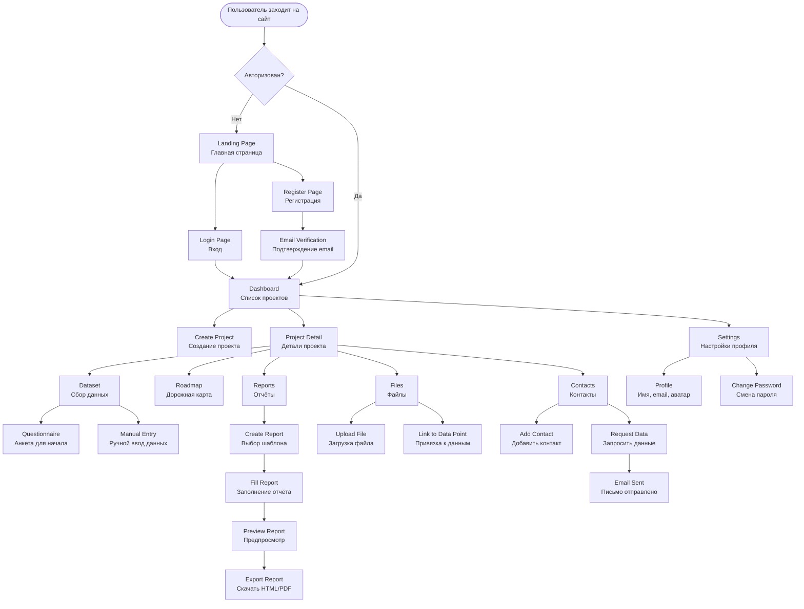
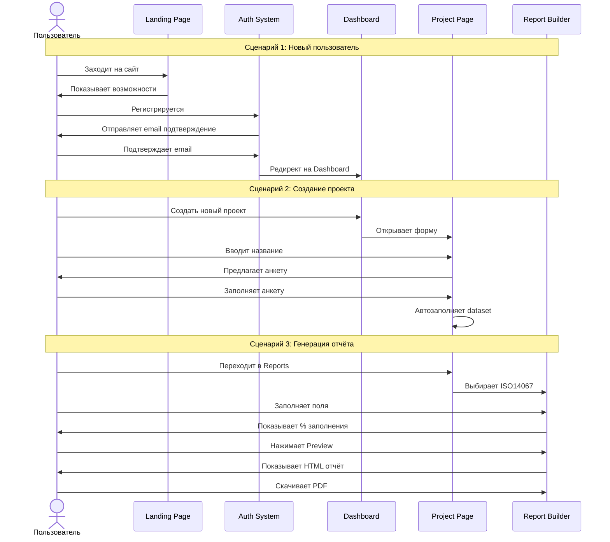
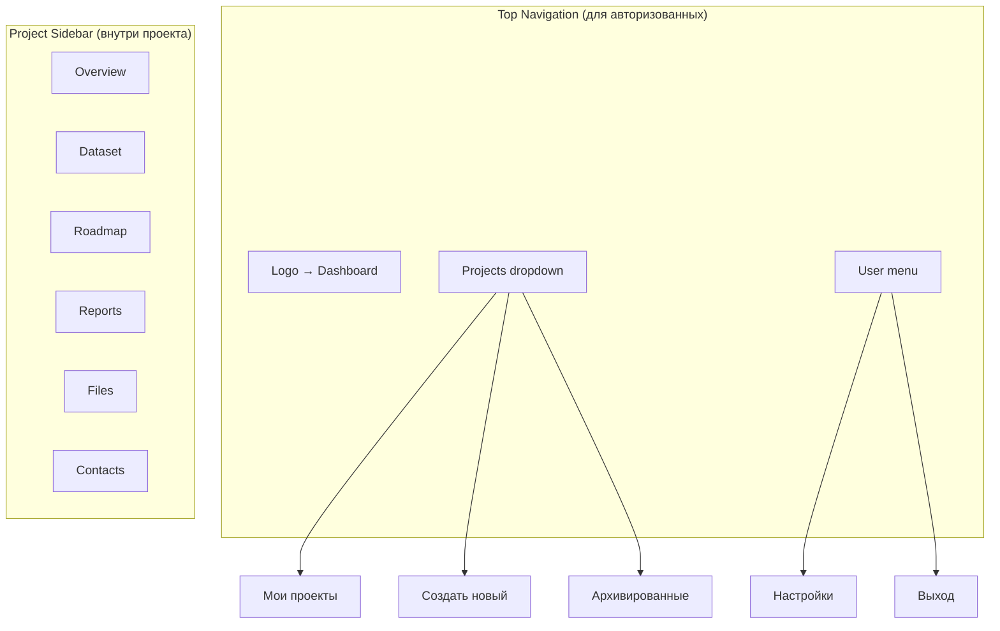

# User Flow & Page Structure

Диаграмма структуры страниц и навигации пользователя в Carbon Report Platform.

## Общая структура навигации



## Детальная структура страниц

```mermaid
graph LR
    subgraph "Public Pages"
        A1[/ <br/>Landing Page]
        A2[/login<br/>Вход]
        A3[/register<br/>Регистрация]
        A4[/verify-email<br/>Подтверждение]
        A5[/forgot-password<br/>Восстановление пароля]
    end
    
    subgraph "Protected Pages (требуют авторизации)"
        B1[/dashboard<br/>Главная]
        
        subgraph "Project Pages"
            C1[/projects/new<br/>Создать проект]
            C2[/projects/:id<br/>Обзор проекта]
            C3[/projects/:id/dataset<br/>Сбор данных]
            C4[/projects/:id/questionnaire<br/>Анкета]
            C5[/projects/:id/roadmap<br/>Дорожная карта]
            C6[/projects/:id/reports<br/>Список отчётов]
            C7[/projects/:id/reports/new<br/>Новый отчёт]
            C8[/projects/:id/reports/:reportId<br/>Редактор отчёта]
            C9[/projects/:id/files<br/>Файлы]
            C10[/projects/:id/contacts<br/>Контакты]
        end
        
        subgraph "Settings Pages"
            D1[/settings<br/>Настройки]
            D2[/settings/profile<br/>Профиль]
            D3[/settings/password<br/>Пароль]
        end
    end
    
    B1 --> C1
    B1 --> C2
    C2 --> C3
    C2 --> C4
    C2 --> C5
    C2 --> C6
    C2 --> C9
    C2 --> C10
    C6 --> C7
    C7 --> C8
    B1 --> D1
    D1 --> D2
    D1 --> D3
```

## Основные User Stories



## Навигационная структура (Header/Sidebar)



## Приоритеты разработки (MVP)

### Phase 1: Аутентификация ✅ Начнём с этого
1. `/login` - Вход
2. `/register` - Регистрация
3. `/verify-email` - Подтверждение email
4. Email sending (Resend)
5. JWT auth middleware

### Phase 2: Dashboard & Projects
1. `/dashboard` - Список проектов
2. `/projects/new` - Создание проекта
3. `/projects/:id` - Обзор проекта
4. CRUD операции для проектов

### Phase 3: Dataset & Roadmap
1. `/projects/:id/dataset` - Сбор данных (JSONB)
2. `/projects/:id/questionnaire` - Анкета
3. `/projects/:id/roadmap` - Чеклист roadmap

### Phase 4: Reports
1. `/projects/:id/reports` - Список отчётов
2. `/projects/:id/reports/new` - Выбор шаблона
3. `/projects/:id/reports/:id` - Редактор отчёта
4. HTML export

### Phase 5: Files & Contacts
1. `/projects/:id/files` - Загрузка файлов
2. S3 integration
3. `/projects/:id/contacts` - Управление контактами
4. Email requests

---

## Технические детали

### Routing (Next.js App Router)
```
src/app/
├── (public)/           # Группа для публичных страниц
│   ├── page.tsx       # Landing /
│   ├── login/
│   └── register/
├── (dashboard)/       # Группа для защищённых страниц
│   ├── layout.tsx     # Layout с навигацией
│   ├── dashboard/
│   ├── projects/
│   │   ├── [id]/
│   │   │   ├── page.tsx
│   │   │   ├── dataset/
│   │   │   ├── reports/
│   │   │   └── ...
│   └── settings/
└── api/               # API Routes
    ├── auth/
    ├── projects/
    └── reports/
```

### Защита маршрутов
- Middleware проверяет JWT токен
- Редирект на `/login` если не авторизован
- Редирект на `/dashboard` если уже авторизован (для public pages)

