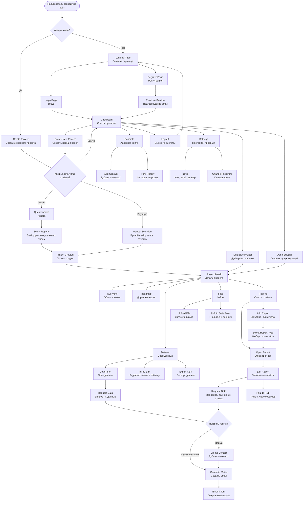
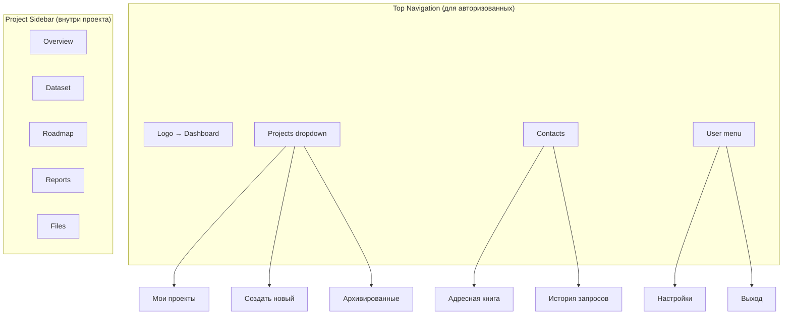

# User Flow & Page Structure

Диаграмма структуры страниц и навигации пользователя в Carbon Report Platform.

## Общая структура навигации



## Детальная структура страниц

```mermaid
graph LR
    subgraph "Public Pages"
        A1[/ <br/>Landing Page]
        A2[/login<br/>Вход]
        A3[/register<br/>Регистрация]
        A4[/verify-email<br/>Подтверждение]
        A5[/forgot-password<br/>Восстановление пароля]
    end
    
    subgraph "Protected Pages (требуют авторизации)"
        B1[/dashboard<br/>Главная]
        B2[/contacts<br/>Глобальная адресная книга]
        
        subgraph "Project Creation Flow"
            C0[/projects/new<br/>Создать проект - Шаг 1]
            C0a[/projects/new/questionnaire<br/>Анкета - опционально]
            C0b[/projects/new/select-reports<br/>Выбор типов отчётов]
        end
        
        subgraph "Project Pages"
            C2[/projects/:id<br/>Обзор проекта]
            C3[/projects/:id/dataset<br/>Сбор данных]
            C5[/projects/:id/roadmap<br/>Дорожная карта]
            C6[/projects/:id/reports<br/>Список отчётов]
            C8[/projects/:id/reports/:reportId<br/>Редактор отчёта]
            C8a[/projects/:id/reports/:reportId/print<br/>Печать отчёта]
            C9[/projects/:id/files<br/>Файлы]
        end
        
        subgraph "Settings Pages"
            D1[/settings<br/>Настройки]
            D2[/settings/profile<br/>Профиль]
            D3[/settings/password<br/>Пароль]
        end
    end
    
    B1 --> C0
    C0 --> C0a
    C0 --> C0b
    C0a --> C0b
    C0b --> C2
    
    B1 --> C2
    B1 --> B2
    
    C2 --> C3
    C2 --> C5
    C2 --> C6
    C2 --> C9
    
    C6 --> C8
    C8 --> C8a
    
    B1 --> D1
    D1 --> D2
    D1 --> D3
```

## Основные User Stories

```mermaid
sequenceDiagram
    actor User as Пользователь
    participant Landing as Landing Page
    participant Auth as Auth System
    participant Dashboard as Dashboard
    participant ProjectNew as Project Creation
    participant Questionnaire as Questionnaire
    participant ProjectPage as Project Page
    participant Dataset as Dataset
    participant Contact as Contact System
    participant Report as Report Editor
    
    Note over User,Report: Сценарий 1: Новый пользователь
    User->>Landing: Заходит на сайт
    Landing->>User: Показывает возможности
    User->>Auth: Регистрируется
    Auth->>User: Отправляет email подтверждение
    User->>Auth: Подтверждает email
    Auth->>ProjectNew: Редирект на создание первого проекта
    
    Note over User,Report: Сценарий 2: Создание проекта через анкету
    User->>ProjectNew: Открывает /projects/new
    User->>ProjectNew: Вводит название проекта
    ProjectNew->>User: Предлагает анкету (+ кнопка "Выйти в Dashboard")
    Note over ProjectNew,User: Кнопка "Выйти в Dashboard" отменяет мастер после подтверждения; пока не нажата "Сохранить", проект не создаётся.
    User->>Questionnaire: Выбирает "Пройти анкету"
    User->>Questionnaire: Отвечает на вопросы
    Questionnaire->>ProjectNew: Рекомендует типы отчётов (ISO14067, CBAM)
    User->>ProjectNew: Подтверждает выбор типов отчётов
    ProjectNew->>ProjectPage: Создаёт проект с выбранными отчётами
    ProjectPage->>User: Показывает обзор проекта
    Note over ProjectPage: Дорожная карта генерируется фоново из незаполненных данных и предзаготовленных хинтов; пока процесс идёт, показывается индикатор загрузки.
    
    Note over User,Report: Сценарий 2б: Создание проекта вручную
    User->>ProjectNew: Открывает /projects/new
    User->>ProjectNew: Вводит название, пропускает анкету
    User->>ProjectNew: Вручную выбирает типы отчётов из списка
    ProjectNew->>ProjectPage: Создаёт проект с выбранными отчётами
    
    Note over User,Report: Сценарий 3а: Запрос данных из Dataset
    User->>ProjectPage: Открывает Dataset
    ProjectPage->>Dataset: Показывает список data points
    User->>Dataset: Видит незаполненное поле "Энергопотребление"
    User->>Dataset: Нажимает "Request Data"
    Dataset->>User: Показывает диалог выбора контакта
    User->>Contact: Выбирает "Иван Петров, Production Manager"
    Contact->>Contact: Создаёт запись в data_requests
    Contact->>User: Генерирует mailto: ссылку с шаблоном
    User->>Contact: Открывает email клиент
    Note over Contact: Даже при ошибке шаблона почтовый клиент открывается с пустым телом; mailto ссылка формируется всегда.
    Note over Contact: Email содержит:<br/>- Название проекта<br/>- Название поля<br/>- Подсказку что нужно<br/>- Контекст
    
    Note over User,Report: Сценарий 3б: Запрос данных из отчёта
    User->>ProjectPage: Открывает Reports → ISO14067
    ProjectPage->>Report: Показывает форму отчёта
    User->>Report: Видит пустое поле "Total Energy Consumption"
    User->>Report: Нажимает "Request Data" рядом с полем
    Report->>Contact: Показывает диалог выбора контакта
    User->>Contact: Выбирает контакт
    Contact->>User: Генерирует mailto: ссылку
    User->>Contact: Открывает email клиент
    Note over Contact: Mailto ссылка не зависит от шаблона; при сбое тело остаётся пустым, но письмо можно отправить.
    
    Note over User,Report: Сценарий 4: Заполнение и экспорт отчёта
    User->>ProjectPage: Переходит в Reports
    ProjectPage->>Report: Показывает список отчётов (ISO14067)
    User->>Report: Открывает ISO14067
    Report->>User: Показывает форму с полями
    User->>Report: Заполняет поля данными
    Report->>User: Обновляет % заполнения (67%)
    User->>Report: Продолжает заполнение
    Report->>User: Показывает 100% заполнение
    User->>Report: Нажимает "Print"
    Report->>User: Открывает print-friendly страницу
    User->>Report: Выбирает "Save as PDF" в браузере
    Report->>User: Сохраняет PDF отчёт
    
    Note over User,Report: Сценарий 5: Работа с датасетом (табличный вид)
    User->>ProjectPage: Открывает Dataset
    ProjectPage->>Dataset: Показывает единую таблицу всех data points (Field ID, Item ID, Value, Updated)
    User->>Dataset: Редактирует ячейки inline и добавляет строки
    Dataset->>User: Показывает индикатор сохранения и подтверждение или ошибку
    User->>Dataset: Нажимает "Export CSV"
    Dataset->>User: Показывает прогресс выгрузки и скачивает dataset.csv
    Note over Dataset: Request Data доступна из той же таблицы через кнопки на ячейках.
    
    Note over User,Report: Сценарий 6: Дублирование проекта
    User->>Dashboard: Видит список проектов
    User->>Dashboard: Нажимает "Duplicate" на проекте
    Dashboard->>Dashboard: Показывает прогресс копирования и даёт возможность отменить
    Dashboard->>ProjectPage: Создаёт копию со всеми данными
    ProjectPage->>User: Открывает "[Original Name] (Copy)"
    Note over Dashboard,ProjectPage: При ошибке отображается toast с возможностью повторить попытку.
    
    Note over User,Report: Сценарий 7: Выход из системы
    User->>Dashboard: Нажимает User menu → Logout
    Dashboard->>Auth: Очищает JWT токен
    Auth->>Landing: Редирект на Landing Page
    Landing->>User: Показывает публичную страницу
```

## Навигационная структура (Header/Sidebar)



## Приоритеты разработки (MVP)

### Phase 1: Аутентификация ✅ Начнём с этого
1. `/login` - Вход
2. `/register` - Регистрация
3. `/verify-email` - Подтверждение email
4. `/forgot-password` - Восстановление пароля
5. **Logout** - Выход из системы (очистка JWT токена, редирект на Landing)
6. Email sending (Resend)
7. JWT auth middleware
8. Редирект после регистрации → `/projects/new` (создание первого проекта)

### Phase 2: Dashboard & Projects
1. `/dashboard` - Список проектов
2. `/projects/new` - Создание проекта (многошаговая форма)
3. `/projects/new/questionnaire` - Анкета (опциональный шаг)
4. `/projects/new/select-reports` - Выбор типов отчётов (обязательный шаг)
5. `/projects/:id` - Обзор проекта
6. CRUD операции для проектов
7. Дублирование проекта

### Phase 3: Global Contacts
1. `/contacts` - Глобальная адресная книга
2. CRUD операции для контактов
3. Просмотр истории запросов данных по контакту

### Phase 4: Dataset & Roadmap
1. `/projects/:id/dataset` - Табличный сбор данных (inline редактирование, фильтры, Request Data, CSV export)
2. Связь data requests с контактами
3. Подсветка заполняемости и фильтры по статусу
4. `/projects/:id/roadmap` - Чеклист roadmap

### Phase 5: Reports
1. `/projects/:id/reports` - Список отчётов проекта
2. Добавление/удаление типов отчётов в проект
3. `/projects/:id/reports/:id` - Редактор отчёта (единый режим)
4. **Request Data прямо из полей отчёта** (та же функциональность)
5. Прогресс заполнения отчёта
6. `/projects/:id/reports/:id/print` - Print-friendly страница
7. Browser print to PDF

### Phase 6: Files
1. `/projects/:id/files` - Загрузка файлов
2. S3 integration
3. Привязка файлов к data points
4. Фильтрация и поиск по файлам

---

## Технические детали

### Routing (Next.js App Router)
```
src/app/
├── (public)/              # Группа для публичных страниц
│   ├── page.tsx          # Landing /
│   ├── login/
│   ├── register/
│   ├── verify-email/
│   └── forgot-password/
├── (dashboard)/          # Группа для защищённых страниц
│   ├── layout.tsx        # Layout с навигацией
│   ├── dashboard/
│   ├── contacts/         # Глобальная адресная книга
│   ├── projects/
│   │   ├── new/
│   │   │   ├── page.tsx              # Шаг 1: Название проекта
│   │   │   ├── questionnaire/        # Шаг 2а: Анкета (опционально)
│   │   │   └── select-reports/       # Шаг 2б/3: Выбор типов отчётов
│   │   └── [id]/
│   │       ├── page.tsx              # Overview
│   │       ├── dataset/
│   │       │   └── page.tsx          # Dataset таблица с Request Data
│   │       ├── roadmap/
│   │       ├── reports/
│   │       │   ├── page.tsx          # Список отчётов
│   │       │   └── [reportId]/
│   │       │       ├── page.tsx      # Редактор отчёта с Request Data
│   │       │       └── print/        # Print-friendly страница
│   │       └── files/
│   └── settings/
│       ├── profile/
│       └── password/
└── api/                  # API Routes
    ├── auth/
    ├── contacts/
    ├── projects/
    ├── reports/
    └── files/
```

### Защита маршрутов
- Middleware проверяет JWT токен
- Редирект на `/login` если не авторизован
- Редирект на `/dashboard` если уже авторизован (для public pages)

