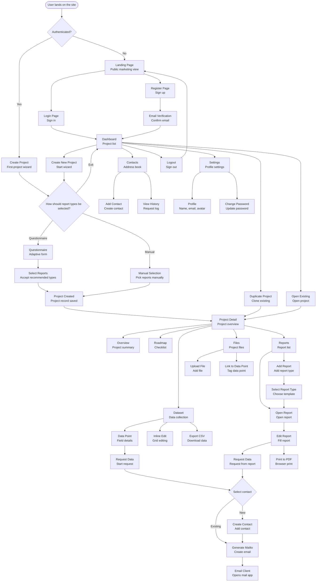
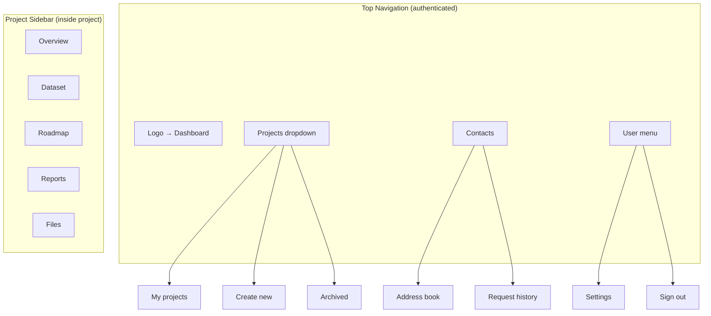

# User Flow & Page Structure

Diagrams describing the page structure and user navigation within the Carbon Report Platform.

## Navigation Overview



## Page Architecture

```mermaid
graph LR
    subgraph "Public Pages"
        A1[/ <br/>Landing Page]
        A2[/login<br/>Sign in]
        A3[/register<br/>Sign up]
        A4[/verify-email<br/>Confirm email]
        A5[/forgot-password<br/>Reset password]
    end

    subgraph "Protected Pages (require auth)"
        B1[/dashboard<br/>Home]
        B2[/contacts<br/>Global address book]

        subgraph "Project Creation Flow"
            C0[/projects/new<br/>Create project - Step 1]
            C0a[/projects/new/questionnaire<br/>Questionnaire - optional]
            C0b[/projects/new/select-reports<br/>Select report types]
        end

        subgraph "Project Pages"
            C2[/projects/:id<br/>Project overview]
            C3[/projects/:id/dataset<br/>Dataset]
            C5[/projects/:id/roadmap<br/>Roadmap]
            C6[/projects/:id/reports<br/>Report list]
            C8[/projects/:id/reports/:reportId<br/>Report editor]
            C8a[/projects/:id/reports/:reportId/print<br/>Print view]
            C9[/projects/:id/files<br/>Files]
        end

        subgraph "Settings Pages"
            D1[/settings<br/>Settings]
            D2[/settings/profile<br/>Profile]
            D3[/settings/password<br/>Password]
        end
    end

    B1 --> C0
    C0 --> C0a
    C0 --> C0b
    C0a --> C0b
    C0b --> C2

    B1 --> C2
    B1 --> B2

    C2 --> C3
    C2 --> C5
    C2 --> C6
    C2 --> C9

    C6 --> C8
    C8 --> C8a

    B1 --> D1
    D1 --> D2
    D1 --> D3
```

## Core User Stories

```mermaid
sequenceDiagram
    actor User as User
    participant Landing as Landing Page
    participant Auth as Auth System
    participant Dashboard as Dashboard
    participant ProjectNew as Project Creation
    participant Questionnaire as Questionnaire
    participant ProjectPage as Project Page
    participant Dataset as Dataset
    participant Contact as Contact Service
    participant Report as Report Editor

    Note over User,Report: Scenario 1 — New user onboarding
    User->>Landing: Visits landing page
    Landing->>User: Shows product overview
    User->>Auth: Completes registration
    Auth->>User: Sends verification email
    User->>Auth: Confirms email
    Auth->>ProjectNew: Redirects to first project wizard

    Note over User,Report: Scenario 2 — Project creation via questionnaire
    User->>ProjectNew: Opens /projects/new
    User->>ProjectNew: Provides project name
    ProjectNew->>User: Offers questionnaire (+ "Exit to Dashboard" button)
    Note over ProjectNew,User: "Exit to Dashboard" cancels the wizard after confirmation; no project is created until "Save" is pressed.
    User->>Questionnaire: Chooses "Start questionnaire"
    User->>Questionnaire: Answers questions
    Questionnaire->>ProjectNew: Suggests report types (ISO14067, CBAM)
    User->>ProjectNew: Confirms recommended reports
    ProjectNew->>ProjectPage: Creates project with selected reports
    ProjectPage->>User: Displays project overview
    Note over ProjectPage: Roadmap is generated in the background from missing data points and predefined hints; a loading indicator remains visible while generation runs.

    Note over User,Report: Scenario 2b — Manual project creation
    User->>ProjectNew: Opens /projects/new
    User->>ProjectNew: Provides name, skips questionnaire
    User->>ProjectNew: Manually selects report types from the list
    ProjectNew->>ProjectPage: Creates project with chosen reports

    Note over User,Report: Scenario 3a — Request data from Dataset
    User->>ProjectPage: Opens Dataset
    ProjectPage->>Dataset: Displays data point grid
    User->>Dataset: Spots empty field “Energy Consumption”
    User->>Dataset: Clicks "Request Data"
    Dataset->>User: Opens contact selection dialog
    User->>Contact: Picks “Ivan Petrov, Production Manager”
    Contact->>Contact: Creates `data_requests` record
    Contact->>User: Generates mailto link with template
    User->>Contact: Opens email client
    Note over Contact: Even if the template fails, the mail client opens with an empty body; the mailto link always exists.
    Note over Contact: Email includes project name, field name, guidance, and context.

    Note over User,Report: Scenario 3b — Request data from report
    User->>ProjectPage: Opens Reports → ISO14067
    ProjectPage->>Report: Shows report form
    User->>Report: Finds empty field “Total Energy Consumption”
    User->>Report: Clicks "Request Data" next to the field
    Report->>Contact: Opens contact selection dialog
    User->>Contact: Selects contact
    Contact->>User: Generates mailto link
    User->>Contact: Opens email client
    Note over Contact: Mailto link is independent of template content; if parsing fails the body stays empty but the email can still be sent.

    Note over User,Report: Scenario 4 — Complete and export report
    User->>ProjectPage: Navigates to Reports
    ProjectPage->>Report: Lists project reports (ISO14067)
    User->>Report: Opens ISO14067 report
    Report->>User: Shows structured form
    User->>Report: Fills in fields
    Report->>User: Updates completion status (67%)
    User->>Report: Continues editing
    Report->>User: Reaches 100% completion
    User->>Report: Clicks "Print"
    Report->>User: Opens print-friendly page
    User->>Report: Chooses "Save as PDF" in browser
    Report->>User: Saves PDF export

    Note over User,Report: Scenario 5 — Work with dataset grid
    User->>ProjectPage: Opens Dataset
    ProjectPage->>Dataset: Shows single spreadsheet view (Field ID, Item ID, Value, Updated)
    User->>Dataset: Edits cells inline and adds rows
    Dataset->>User: Shows saving indicator with success or error toast
    User->>Dataset: Clicks "Export CSV"
    Dataset->>User: Displays export progress and downloads dataset.csv
    Note over Dataset: Request Data actions are available directly from row or cell controls.

    Note over User,Report: Scenario 6 — Duplicate project
    User->>Dashboard: Reviews project list
    User->>Dashboard: Clicks "Duplicate" on project
    Dashboard->>Dashboard: Displays cloning progress with cancel option
    Dashboard->>ProjectPage: Creates copy with all data
    ProjectPage->>User: Opens "[Original Name] (Copy)"
    Note over Dashboard,ProjectPage: Errors display as toast notifications with retry action.

    Note over User,Report: Scenario 7 — Sign out
    User->>Dashboard: Opens user menu → Logout
    Dashboard->>Auth: Clears JWT token
    Auth->>Landing: Redirects to landing page
    Landing->>User: Shows public marketing page
```

## Navigation Structure (Header & Sidebar)



## Delivery Priorities (MVP)

### Phase 1: Authentication ✅ start here
1. `/login` — Sign in
2. `/register` — Sign up
3. `/verify-email` — Email confirmation
4. `/forgot-password` — Password reset
5. **Logout** — Clear JWT token and redirect to landing
6. Email sending (Resend)
7. JWT auth middleware
8. Post-registration redirect → `/projects/new` (first project setup)

### Phase 2: Dashboard & Projects
1. `/dashboard` — Project list
2. `/projects/new` — Multi-step project creation
3. `/projects/new/questionnaire` — Optional questionnaire step
4. `/projects/new/select-reports` — Required report selection step
5. `/projects/:id` — Project overview
6. Project CRUD operations
7. Project duplication

### Phase 3: Global Contacts
1. `/contacts` — Global address book
2. Contact CRUD operations
3. View data-request history per contact

### Phase 4: Dataset & Roadmap
1. `/projects/:id/dataset` — Spreadsheet data capture (inline editing, filters, Request Data, CSV export)
2. Associate data requests with contacts
3. Highlight completion and status filters
4. `/projects/:id/roadmap` — Roadmap checklist

### Phase 5: Reports
1. `/projects/:id/reports` — Project report list
2. Add/remove report types within project
3. `/projects/:id/reports/:id` — Single-mode report editor
4. **Request Data directly from report fields** (same UX as dataset)
5. Report completion tracking
6. `/projects/:id/reports/:id/print` — Print-friendly view
7. Browser print to PDF

### Phase 6: Files
1. `/projects/:id/files` — File uploads
2. S3 integration
3. Link files to data points
4. File filtering and search

---

## Technical Notes

### Routing (Next.js App Router)
```
src/app/
├── (public)/              # Public-facing pages
│   ├── page.tsx          # Landing /
│   ├── login/
│   ├── register/
│   ├── verify-email/
│   └── forgot-password/
├── (dashboard)/          # Protected pages
│   ├── layout.tsx        # Layout with navigation
│   ├── dashboard/
│   ├── contacts/         # Global address book
│   ├── projects/
│   │   ├── new/
│   │   │   ├── page.tsx              # Step 1: Project name
│   │   │   ├── questionnaire/        # Step 2a: Optional questionnaire
│   │   │   └── select-reports/       # Step 2b/3: Choose report types
│   │   └── [id]/
│   │       ├── page.tsx              # Overview
│   │       ├── dataset/
│   │       │   └── page.tsx          # Dataset grid with Request Data
│   │       ├── roadmap/
│   │       ├── reports/
│   │       │   ├── page.tsx          # Report list
│   │       │   └── [reportId]/
│   │       │       ├── page.tsx      # Report editor with Request Data
│   │       │       └── print/        # Print-friendly view
│   │       └── files/
│   └── settings/
│       ├── profile/
│       └── password/
└── api/                  # API Routes
    ├── auth/
    ├── contacts/
    ├── projects/
    ├── reports/
    └── files/
```

### Route Protection
- Middleware validates JWT token
- Redirect to `/login` when unauthenticated
- Redirect to `/dashboard` if already authenticated while visiting public pages

