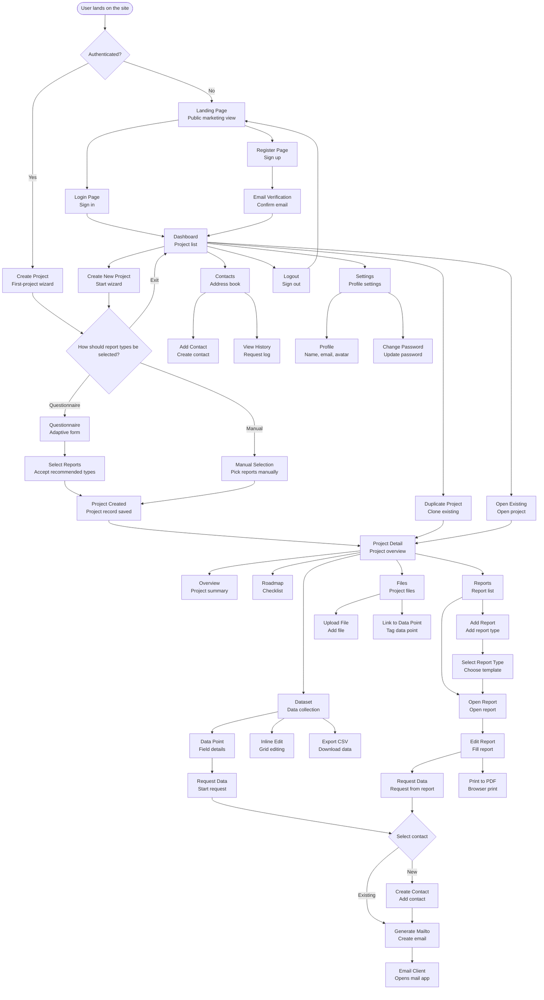
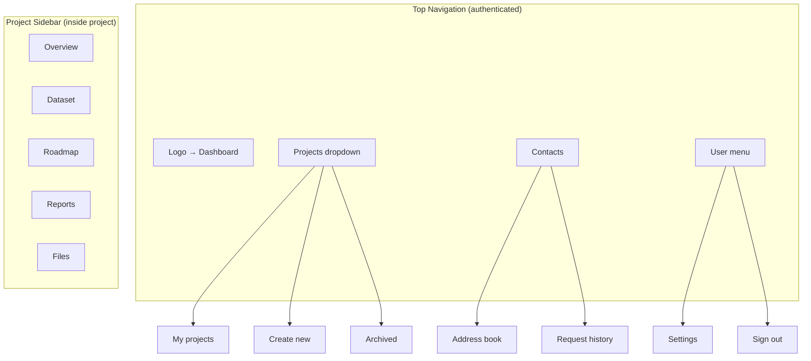

# UX Guide & Information Architecture
## Page Architecture

```mermaid
graph LR
  subgraph "Public Pages"
    A1[/ <br/>Landing Page]
    A2[/login<br/>Sign in]
    A3[/register<br/>Sign up]
    A4[/verify-email<br/>Confirm email]
    A5[/forgot-password<br/>Reset password]
  end

  subgraph "Protected Pages (require auth)"
    B1[/dashboard<br/>Home]
    B2[/contacts<br/>Global address book]

    subgraph "Project Creation Flow"
      C0[/projects/new<br/>Create project - Step 1]
      C0a[/projects/new/questionnaire<br/>Questionnaire - optional]
      C0b[/projects/new/select-reports<br/>Select report types]
    end

    subgraph "Project Pages"
      C2[/projects/:id<br/>Project overview]
      C3[/projects/:id/dataset<br/>Dataset]
      C5[/projects/:id/roadmap<br/>Roadmap]
      C6[/projects/:id/reports<br/>Report list]
      C8[/projects/:id/reports/:reportId<br/>Report editor]
      C8a[/projects/:id/reports/:reportId/print<br/>Print view]
      C9[/projects/:id/files<br/>Files]
    end

    subgraph "Settings Pages"
      D1[/settings<br/>User settings overview]
      D2[/settings/profile<br/>Profile]
      D3[/settings/password<br/>Password]
      D4[/settings/organizations<br/>Organizations list]
    end

    subgraph "Organization Settings"
      E1[/settings/organization<br/>Organization profile]
      E2[/settings/organization/members<br/>Members]
      E3[/settings/organization/usage<br/>Usage & Limits]
      E4[/settings/organization/danger<br/>Danger Zone]
    end
  end

  B1 --> C0
  C0 --> C0a
  C0 --> C0b
  C0a --> C0b
  C0b --> C2

  B1 --> C2
  B1 --> B2

  C2 --> C3
  C2 --> C5
  C2 --> C6
  C2 --> C9

  C6 --> C8
  C8 --> C8a

  B1 --> D1
  D1 --> D2
  D1 --> D3
  D1 --> D4

  B1 --> E1
  E1 --> E2
  E1 --> E3
  E1 --> E4
```

### Organization Settings

- **URL**: `/settings/organization`
- **Tabs**: Profile (default), Members, Usage & Limits, Danger Zone. Persist last tab via query parameter `?tab=` for deep linking.
- **Header**: organization name, plan pill, `Plan valid until` countdown badge when applicable, primary `Upgrade plan` button (opens modal).

#### Profile Tab

- **Fields**: Display name (required, max 64 chars), Description (optional, 400 chars, shows character counter), Logo upload (square recommendation, PNG/JPEG/SVG ≤512 KB), Slug (read-only token used in URLs), Plan code + Valid until (read-only).
- **Logo upload flow**: uses `<AvatarUploader />` pattern with the following states:
  - Empty: initials fallback badge with upload CTA.
  - Uploading: progress bar with cancel button; disable Save until upload completes.
  - Success: thumbnail preview with `Replace` and `Remove` buttons.
  - Error: inline error message (`"Upload failed. Please retry."`) with `Retry` button referencing the signed URL flow.
- **Validation**: show inline errors for empty name, overlength description, unsupported file type, and size >512 KB. Disable Save when no changes. Success toast `"Organization profile updated."` appears after PATCH.

#### Members Tab

- **Table columns**: Avatar, Name, Email, Role badge, Last active (relative, fallback `—`), Status (Active/Pending). Actions column with `Change role`, `Remove`, `Resend invite`.
- **Invite flow**: `Invite member` button opens modal with fields `Email` (required), `Role` radio buttons, optional note (future). Show plan usage chip for Editor/Verifier (`"0 / 0 seats available"`). Disable selection when limit reached with tooltip `"Upgrade plan to add more editors."`
- **Role changes**: inline dropdown; confirm dialog summarises impact (`"This will free an editor seat."`). API errors surface toast with reason (e.g., `PLAN_LIMIT_EXCEEDED`).
- **Ownership guardrails**: owner row hides Remove button and shows tooltip `"Transfer ownership coming soon."`. Owners can demote Admins, Admins cannot affect Owners.
- **Empty state**: card with illustration, headline `"Invite teammates"`, copy explaining unlimited viewers on Free plan, and `Invite member` CTA.

#### Usage & Limits Tab

- **Metrics cards**: Active projects, Editors, Verifiers (flagged `Coming soon`), Viewers. Each card displays `current / limit`, progress bar (green <=80%, amber between 80-100%, red on overflow), and tooltip `"Limit from Free plan"`.
- **Snapshots table**: simple table with `computed_at`, `active_projects`, `active_editors`, `active_verifiers`, `active_viewers`. Future enhancement reserved for charts.
- **Upgrade CTA**: prominent `Upgrade plan` button plus `Contact support` secondary link (mailto). When plan is expiring (`plan_valid_until` within 14 days) show warning banner `"Pro Beta expires on {date}."`
- **Error handling**: if usage endpoint fails, show inline banner with `Retry`. Loading state uses skeleton cards.

#### Danger Zone Tab

- **Sections**:
  - `Delete organization`: explains 30-day retention and that active projects will be marked deleted. Confirmation input requires typing the organization slug; disable button until match.
  - `Restore projects`: link to `/projects?status=deleted` with helper copy `"You can restore deleted projects here before retention ends."`
  - `Transfer ownership` placeholder: greyed-out card stating `"Ownership transfer coming soon"`.
- **Delete flow**: on submit, call DELETE endpoint; show spinner and then success toast `"Organization scheduled for deletion."` followed by redirect to dashboard. If already pending deletion, disable button and display badge `"Scheduled on {date}"`.

### User Settings

- **URL**: `/settings`
- **Primary layout**: two-column form (fields left, contextual guidance right) on desktop, single column on mobile.
- **Tabs**: Profile (default), Password, Organizations. Tabs persist using shallow routing (`?tab=`) for deep links.

#### Profile Tab

- **Fields**:
  - First name (required), Last name (required), Job title (optional, max 64 chars).
  - Email (read-only with helper text `"Email changes will be available after beta."`).
  - Timezone select (future; placeholder disabled with tooltip `"Coming soon"`).
  - Avatar upload button using the same `<AvatarUploader />` component as organization logos.
- **Actions**: Save button disabled until change detected; `Reset` link reverts unsaved edits. Success toast `"Profile updated."`.
- **Avatar states**: identical to organization logo (empty, uploading, success, error). Provide crop guidance (square) in helper text.

#### Password Tab

- **Form**: Current password, New password, Confirm password. Submit triggers `POST /api/user/settings/password` (stub until backend ready).
- **Validation**: show inline errors for mismatch, insufficient complexity, missing fields. Disable submit until validation passes.
- **Success state**: toast `"Password updated."` and auto-clear inputs. Failure surfaces API message.
- **Forgot password link**: inline link to `/forgot-password` for fallback.

#### Organizations Tab

- **Content**: list of organizations where user is a member. Each item shows organization logo, name, plan pill, role badge, `Last active` timestamp.
- **Actions**:
  - `Open` button → switches context and navigates to organization dashboard.
  - `Leave organization` (for non-owners) with confirm dialog explaining lost access. Owners see tooltip `"Transfer ownership before leaving."`.
  - `Create organization` button persists (same as switcher) for quick access.
- **Empty state**: copy `"You are not a member of any organizations yet."` with `Create organization` CTA.

### User Settings

- **URL**: `/settings`
- **Primary layout**: two-column form (fields left, contextual guidance right) on desktop, single column on mobile.
- **Tabs**: Profile (default), Password, Organizations. Tabs persist using shallow routing (`?tab=`) for deep links.

#### Profile Tab

- **Fields**:
  - First name (required), Last name (required), Job title (optional, max 64 chars).
  - Email (read-only with helper text `"Email changes will be available after beta."`).
  - Timezone select (future; placeholder disabled with tooltip `"Coming soon"`).
  - Avatar upload button using the same `<AvatarUploader />` component as organization logos.
- **Actions**: Save button disabled until change detected; `Reset` link reverts unsaved edits. Success toast `"Profile updated."`.
- **Avatar states**: identical to organization logo (empty, uploading, success, error). Provide crop guidance (square) in helper text.

#### Password Tab

- **Form**: Current password, New password, Confirm password. Submit triggers `POST /api/user/settings/password` (stub until backend ready).
- **Validation**: show inline errors for mismatch, insufficient complexity, missing fields. Disable submit until validation passes.
- **Success state**: toast `"Password updated."` and auto-clear inputs. Failure surfaces API message.
- **Forgot password link**: inline link to `/forgot-password` for fallback.

#### Organizations Tab

- **Content**: list of organizations where user is a member. Each item shows organization logo, name, plan pill, role badge, `Last active` timestamp.
- **Actions**:
  - `Open` button → switches context and navigates to organization dashboard.
  - `Leave organization` (for non-owners) with confirm dialog explaining lost access. Owners see tooltip `"Transfer ownership before leaving."`.
  - `Create organization` button persists (same as switcher) for quick access.
- **Empty state**: copy `"You are not a member of any organizations yet."` with `Create organization` CTA.
| `/settings/password` | `POST /api/user/settings/password` | Modal form collects current/new password once backend available. |
| `/settings/organizations` | `GET /api/organizations`, `POST /api/organizations` | Lists memberships with role tags, provides `Leave organization` (DELETE membership) except for owners. |
| Upgrade Plan modal | `GET /api/plan-definitions`, `POST /api/organizations/:id/plan/upgrade` (501) | Modal shows plan comparison, contact info, logs intent via 501 endpoint for future billing audit trail. |
│   ├── Login (/login)
│   ├── Register (/register)
│   ├── Email Verification (/verify-email)
│   └── Forgot Password (/forgot-password)
│
└── Protected (authenticated)
  ├── Dashboard (/dashboard)
  │   └── Project list with actions
  │
  ├── Contacts (/contacts)
  │   ├── Address book grid
  │   └── Request history per contact
  │
  ├── Project Creation Flow (/projects/new)
  │   ├── Step 1: Project name
  │   ├── Step 2 (optional): Questionnaire
  │   └── Step 3: Select report types
  │
  ├── Project Workspace (/projects/:id)
  │   ├── Overview (/projects/:id) — includes Roadmap
  │   ├── Dataset (/projects/:id/dataset)
  │   ├── Reports (/projects/:id/reports)
  │   │   ├── Report list
  │   │   └── Report editor (/projects/:id/reports/:reportId)
  │   │       └── Print view (/projects/:id/reports/:reportId/print)
  │   └── Files (/projects/:id/files)
  │
  ├── Organization Settings (/settings/organization)
  │   ├── Profile (default tab)
  │   ├── Members
  │   ├── Usage & Limits
  │   └── Danger Zone
  │
  └── User Settings (/settings)
    ├── Profile (/settings/profile)
    ├── Password (/settings/password)
    └── Organizations (/settings/organizations)
```

### Layout Templates

The platform uses **4 distinct layout templates**:

#### 1. `PublicLayout` (unauthenticated pages)
**Used by**: Landing, Login, Register, Verify Email, Forgot Password

**Structure**:
```
┌─────────────────────────────────────┐
│ Header: Logo + Login/Register btns  │
├─────────────────────────────────────┤
│                                     │
│         Page Content                │
│         (centered, max-w-4xl)       │
│                                     │
├─────────────────────────────────────┤
│ Footer: Links, Copyright            │
└─────────────────────────────────────┘
```

**Components**:
- `<PublicHeader />` — Logo, navigation links, CTA buttons
- `<Footer />` — Site links, legal, social media
- `<AuthCard />` — Centered card for auth forms

---

#### 2. `DashboardLayout` (main authenticated pages)
**Used by**: Dashboard, Contacts, Settings

**Structure**:
```
┌──────────┬──────────────────────────┐
│          │                          │
│          │   Page Content           │
│ Sidebar  │   (main workspace)       │
│          │                          │
│ Dashboard│                          │
│ Projects │                          │
│ Contacts │                          │
│ Settings │                          │
│          │                          │
│ ─────────│                          │
│ User     │                          │
│          │                          │
└──────────┴──────────────────────────┘
```

**Components**:
- `<MainSidebar />` — Left sidebar with main navigation (Dashboard, Projects, Contacts, Settings)
- `<UserMenu />` — At bottom of sidebar: Avatar, name, logout
- `<Breadcrumbs />` — At top of content area

---

#### 3. `ProjectLayout` (project-specific pages)
**Used by**: All `/projects/:id/*` routes (Overview, Dataset, Reports, Files)

**Structure**:
```
┌──────────┬──────────────────────────┐
│          │                          │
│          │  Project Header          │
│ Main     │  [Project Name] [Badge]  │
│ Sidebar  │                          │
│          │  ┌─────────────────────┐ │
│ Dashboard│  │ Tabs: Overview |    │ │
│ Projects │  │ Dataset | Reports | │ │
│ Contacts │  │ Files               │ │
│ Settings │  └─────────────────────┘ │
│          │                          │
│          │   Tab Content            │
│ ─────────│   (Overview shows        │
│ User     │    Roadmap inside)       │
│          │                          │
└──────────┴──────────────────────────┘
```

**Components**:
- `<MainSidebar />` — Same as DashboardLayout (left sidebar)
- `<ProjectHeader />` — Project name, status badge, actions
- `<ProjectTabs />` — Horizontal tabs: Overview, Dataset, Reports, Files
- `<ProjectBreadcrumbs />` — Dashboard > Projects > [Project Name]

**Note**: Roadmap is integrated into Overview tab, not a separate tab

---

#### 4. `PrintLayout` (report export)
**Used by**: `/projects/:id/reports/:reportId/print`

**Structure**:
```
┌─────────────────────────────────────┐
│                                     │
│   Report Header (logo, metadata)    │
│                                     │
│   Report Content                    │
│   (optimized for PDF)               │
│                                     │
│   Footer (page numbers, date)       │
│                                     │
└─────────────────────────────────────┘
```

**Features**:
- No navigation elements
- Print-optimized CSS (`@media print`)
- A4 page breaks
- High-contrast text
- No interactive elements

---

### Reusable Page Blocks

These are **composite components** used across multiple pages:

#### Data & Content Blocks

**`<ProjectCard />`** — Used in: Dashboard
```tsx
ProjectCard {
  - Thumbnail/icon
  - Project name
  - Status badge (Active/Archived)
  - Completion percentage
  - Last updated timestamp
  - Quick actions: Open, Duplicate, Archive
}
```

**`<DataPointRow />`** — Used in: Dataset, Report Editor
```tsx
DataPointRow {
  - Field ID (snake_case, from DB)
  - Label (from template)
  - Value input (text, number, date, etc.)
  - "Request Data" button
  - Last updated indicator
  - Validation status icon
  - Responsible column displays the latest pending contact name when requests exist; otherwise shows "—".
    * Repeatable groups surface the latest pending contact across their items.
    * Reassignment still flows through the Request Data dialog (no inline summary click target yet).
}
```

**`<ReportCard />`** — Used in: Project Reports list
```tsx
ReportCard {
  - Template icon (ISO14067, CBAM)
  - Template name
  - Completion bar (0-100%)
  - Last updated
  - Actions: Open, Print, Remove
}
```

**`<ContactSelector />`** — Used in: Request Data dialogs
```tsx
ContactSelector {
  - Search/filter contacts
  - Contact list (name, position, company)
  - "Create new contact" inline form
  - Select button
}
```

**`<RequestDataDialog />`** — Used in: Dataset, Report Editor
```tsx
RequestDataDialog {
  - Field name display
  - <ContactSelector />
  - Mailto template preview
  - "Send Request" button (opens email client)
  - Request history for this field
}
```

**`<FileUploadZone />`** — Used in: Files page, Contact forms
```tsx
FileUploadZone {
  - Drag-and-drop area
  - File browser button
  - Upload progress indicator
  - File list with thumbnails
  - Link to data point selector
}
```

---

#### Navigation Blocks

**`<Breadcrumbs />`** — Used in: All dashboard pages
```tsx
Breadcrumbs {
  - Dashboard > Projects > [Project Name] > Dataset
  - Clickable navigation trail
  - Current page highlighted
}
```

**`<Pagination />`** — Used in: Dashboard, Contacts, Dataset (if large)
```tsx
Pagination {
  - Page numbers
  - Prev/Next buttons
  - Items per page selector
  - Total count display
}
```

**`<Tabs />`** — Used in: Settings, Project Overview
```tsx
Tabs {
  - Tab list (Profile, Password, etc.)
  - Active tab indicator
  - Tab panels with content
}
```

---

#### Forms & Inputs

**`<DataTable />`** — Used in: Dataset, Contacts
```tsx
DataTable {
  - Column headers (sortable)
  - Row selection checkboxes
  - Inline editing (double-click cell)
  - Filters per column
  - Bulk actions toolbar
  - Export CSV button
}
```

**`<WizardSteps />`** — Used in: Project Creation flow
```tsx
WizardSteps {
  - Step indicators (1/3, 2/3, 3/3)
  - Progress bar
  - Back/Next buttons
  - "Exit to Dashboard" button
  - Step validation
}
```

**`<FormFieldGroup />`** — Used in: All forms
```tsx
FormFieldGroup {
  - Label with required indicator
  - Input component (varies by type)
  - Helper text / placeholder
  - Validation error message
  - "Request Data" button (for report fields)
}
```

---

#### Status & Feedback

**`<CompletionBar />`** — Used in: Project cards, Reports, Roadmap
```tsx
CompletionBar {
  - Percentage display (33%)
  - Progress bar (colored by completion)
  - Filled vs Required count (5/15)
}
```

**`<StatusBadge />`** — Used in: Projects, Reports, Contacts
```tsx
StatusBadge {
  - Color-coded (green=Active, gray=Archived, red=Error)
  - Icon + text label
  - Variants: project status, request status, validation status
}
```

**`<Toast />`** — Used in: All pages (for notifications)
```tsx
Toast {
  - Success/Error/Warning/Info variants
  - Auto-dismiss after 5s
  - Action button (Undo, Retry)
  - Close button
}
```

**`<EmptyState />`** — Used in: Dashboard (no projects), Contacts (empty), Files (no uploads)
```tsx
EmptyState {
  - Illustration/icon
  - Title ("No projects yet")
  - Description ("Create your first project to get started")
  - Primary CTA button
}
```

---

### Component Hierarchy

```
Pages (unique, route-specific)
│
├── Layout Templates (4 types)
│   ├── PublicLayout
│   ├── DashboardLayout
│   ├── ProjectLayout
│   └── PrintLayout
│
├── Page Blocks (composite, reusable)
│   ├── <ProjectCard />
│   ├── <DataPointRow />
│   ├── <ReportCard />
│   ├── <ContactSelector />
│   ├── <RequestDataDialog />
│   ├── <FileUploadZone />
│   ├── <Breadcrumbs />
│   ├── <Pagination />
│   ├── <DataTable />
│   ├── <WizardSteps />
│   ├── <CompletionBar />
│   ├── <StatusBadge />
│   └── <EmptyState />
│
└── UI Components (atomic, from DESIGN_SYSTEM.md)
    ├── <Button />
    ├── <Input />
    ├── <Select />
    ├── <Card />
    ├── <Dialog />
    ├── <Dropdown />
    ├── <Badge />
    ├── <Avatar />
    ├── <Checkbox />
    └── ...50+ more from shadcn/ui
```

**Implementation Location**:
- **Pages**: `src/app/**/*.tsx`
- **Layout Templates**: `src/app/(public)/layout.tsx`, `src/app/(dashboard)/layout.tsx`
- **Page Blocks**: `src/components/blocks/`
- **UI Components**: `src/components/ui/` (from shadcn/ui)

---

### Page-to-API Mapping

This table shows which API endpoints each page uses:

| Page | API Endpoints | Data Flow |
|------|---------------|-----------|
| **Dashboard** | `GET /api/projects` | Fetches all projects with status, completion |
| **Create Project** | `POST /api/projects` | Creates project with mailtoTemplates, dataset, reports |
| **Project Overview** | `GET /api/projects/:id` | Project metadata, stats |
| **Dataset** | `GET /api/projects/:id/dataset`<br>`PUT /api/projects/:id/dataset` | Fetch dataset + version<br>Update with optimistic locking |
| **Roadmap** | `GET /api/projects/:id` (checklist field) | Roadmap items from Project.checklist JSONB |
| **Reports List** | `GET /api/projects/:id` (with reports relation) | List of reports with templateCode, completion |
| **Report Editor** | `GET /api/projects/:id/reports/:reportId` | Template config + filtered dataset + completion |
| **Report Print** | Same as Report Editor | Read-only view, no API calls on render |
| **Files** | `GET /api/projects/:id/files`<br>`POST /api/projects/:id/files` | List files<br>Upload to S3 |
| **Contacts** | `GET /api/contacts`<br>`POST /api/contacts` | List all user contacts<br>Create contact |
| **Data Requests Board** | `GET /api/projects/:id/data-requests`<br>`POST /api/data-requests/bulk` | Table of requests per project<br>Create/update bulk assignments |
| **Requests Overview** | `GET /api/data-requests` (planned)<br>`POST /api/data-requests/bulk` | Aggregated requests across projects<br>Reuse bulk logging actions |
| **Request Data (inline)** | `POST /api/data-requests/bulk` | Bulk or single request logging after mailto launch |
| **Mailto Templates** | `GET /api/projects/:id/mailto-template`<br>`PUT /api/projects/:id/mailto-template`<br>`POST /api/projects/:id/mailto-template/reset` | Get current template<br>Update subject/body<br>Reset to default |
| **Settings** | `GET /api/users/me`<br>`PUT /api/users/me` | Current user info<br>Update profile |

### Data Requests Board (Project-level view)
- **Purpose**: centralise outstanding/past requests per project with filtering, bulk actions, and quick status review.
- **Columns**: Field (label + optional item id + hint), Contact (name + email), Status badge (pending/completed/revoked), timestamps (requested/completed/revoked), deadline.
- **Filters**: Status pill group (All/Pending/Completed/Revoked, future Overdue), contact dropdown, search (future).
- **Bulk actions**: Resend email, Mark complete, Revoke, Clear selection. Disable when selection invalid (e.g., zero pending). Display count summary `“3 selected · 2 pending”`.
- **Feedback**: Inline success/error toasts; keep selection on error; clear selection on success.
- **Optimistic UI (planned)**: allow immediate visual updates while API runs; maintain snapshot for rollback and trigger refetch after success.
- **Performance**: measure handler durations via instrumentation; migrate to row virtualisation (e.g., `react-window`) once row count regularly exceeds ~200 to keep scroll responsive.
- **Empty state**: dashed card with explanatory copy, CTA to adjust filters or request data.

### Requests Page (Global view)
- **Purpose**: consolidate every data request across projects so operations can triage in one place.
- Sidebar entry `/requests` lists `Project`, `Field`, `Contact`, `Status`, `Requested / Completed / Revoked`, and `Deadline` columns with quick links back to the originating project.
- Filters: project selector, status segments (All/Pending/Completed/Revoked), deadline buckets (due soon, overdue), optional text search.
- Quick actions reuse the existing Request Data modal plus complete/revoke endpoints; mutations invalidate both project-level and global caches for consistency.
- Contact detail pages surface the same dataset inside a "Requests" tab, showing chronological history per contact and enabling repeat/close actions inline.

**Key Patterns**:
- **Optimistic Locking**: Dataset page sends `datasetVersion` with PUT, handles 409 Conflict
- **Filtered Views**: Report Editor reads `Project.dataset`, filters by template field_ids
- **Mailto Generation**: Client-side, no API call (uses `Project.mailto_template` with placeholders `{{contact_name}}`, `{{project_name}}`, `{{field_display_name}}`, `{{field_list}}`, `{{deadline}}`, `{{requester_signature}}`)

---

## Navigation Overview



### Organization Switcher

## Page Architecture

```mermaid
graph LR
    subgraph "Public Pages"
        A1[/ <br/>Landing Page]
        A2[/login<br/>Sign in]
        A3[/register<br/>Sign up]
        A4[/verify-email<br/>Confirm email]
        A5[/forgot-password<br/>Reset password]
    end

    subgraph "Protected Pages (require auth)"
        B1[/dashboard<br/>Home]
        B2[/contacts<br/>Global address book]

        subgraph "Project Creation Flow"
            C0[/projects/new<br/>Create project - Step 1]
            C0a[/projects/new/questionnaire<br/>Questionnaire - optional]
            C0b[/projects/new/select-reports<br/>Select report types]
        end

    subgraph "Project Pages"
      C2[/projects/:id<br/>Project overview]
      C3[/projects/:id/dataset<br/>Dataset]
      C5[/projects/:id/roadmap<br/>Roadmap]
      C6[/projects/:id/reports<br/>Report list]
      C8[/projects/:id/reports/:reportId<br/>Report editor]
      C8a[/projects/:id/reports/:reportId/print<br/>Print view]
      C9[/projects/:id/files<br/>Files]
    end

    subgraph "Settings Pages"
      D1[/settings<br/>User settings overview]
      D2[/settings/profile<br/>Profile]
      D3[/settings/password<br/>Password]
      D4[/settings/organizations<br/>Organizations list]
    end

    subgraph "Organization Settings"
      E1[/settings/organization<br/>Organization profile]
      E2[/settings/organization/members<br/>Members]
      E3[/settings/organization/usage<br/>Usage & Limits]
      E4[/settings/organization/danger<br/>Danger Zone]
    end
    end

    B1 --> C0
    C0 --> C0a
    C0 --> C0b
    C0a --> C0b
    C0b --> C2

    B1 --> C2
    B1 --> B2

    C2 --> C3
    C2 --> C5
    C2 --> C6
    C2 --> C9

    C6 --> C8
    C8 --> C8a

    B1 --> D1
    D1 --> D2
    D1 --> D3
```

## Core User Stories

```mermaid
sequenceDiagram
    actor User as User
    participant Landing as Landing Page
    participant Auth as Auth System
    participant Dashboard as Dashboard
    participant ProjectNew as Project Creation
    participant Questionnaire as Questionnaire
    participant ProjectPage as Project Page
    participant Dataset as Dataset
    participant Contact as Contact Service
    participant Report as Report Editor

    Note over User,Report: Scenario 1 — New user onboarding
    User->>Landing: Visits landing page
    Landing->>User: Shows product overview
    User->>Auth: Completes registration
    Auth->>User: Sends verification email
    User->>Auth: Confirms email
    Auth->>ProjectNew: Redirects to first project wizard

    Note over User,Report: Scenario 2 — Project creation via questionnaire
    User->>ProjectNew: Opens /projects/new
    User->>ProjectNew: Provides project name
    ProjectNew->>User: Offers questionnaire (+ "Exit to Dashboard" button)
    Note over ProjectNew,User: "Exit to Dashboard" cancels the wizard after confirmation; no project is created until "Save" is pressed.
    User->>Questionnaire: Chooses "Start questionnaire"
    User->>Questionnaire: Answers questions
    Questionnaire->>ProjectNew: Suggests report types (ISO14067, CBAM)
    User->>ProjectNew: Confirms recommended reports
    ProjectNew->>ProjectPage: Creates project with selected reports
    ProjectPage->>User: Displays project overview
    Note over ProjectPage: Roadmap is generated in the background from missing data points and predefined hints; a loading indicator remains visible while generation runs.

    Note over User,Report: Scenario 2b — Manual project creation
    User->>ProjectNew: Opens /projects/new
    User->>ProjectNew: Provides name, skips questionnaire
    User->>ProjectNew: Manually selects report types from the list
    ProjectNew->>ProjectPage: Creates project with chosen reports

    Note over User,Report: Scenario 3a — Request data from Dataset
    User->>ProjectPage: Opens Dataset
    ProjectPage->>Dataset: Displays data point grid
  User->>Dataset: Spots several empty fields (“Energy Consumption”, “Grid Emission Factor”)
  User->>Dataset: Selects them via checkboxes and clicks "Request Data"
  Dataset->>User: Opens bulk dialog with contact picker and preview (using `{{field_list}}`)
  User->>Contact: Picks “Ivan Petrov, Production Manager”
  Contact->>Contact: Creates/updates `data_requests` rows (revoking previous assign if needed)
  Contact->>User: Generates mailto link with bullet list of selected fields
  User->>Contact: Opens email client
  Note over Contact: Even if the template fails, the mail client opens with an empty body; the mailto link always exists.
  Note over Contact: Email includes project name, a bullet list of fields, hints, and contextual guidance.

    Note over User,Report: Scenario 3b — Request data from report
    User->>ProjectPage: Opens Reports → ISO14067
    ProjectPage->>Report: Shows report form
  User->>Report: Finds empty field “Total Energy Consumption”
  User->>Report: Clicks "Request Data" next to the field (can also add the field to the bulk selection)
  Report->>Contact: Opens dialog with the current assignee and options to reassign
  User->>Contact: Selects the existing contact or reassigns to another person
  Contact->>Contact: Updates `data_requests` (sets `revoked_at` for the previous assignee and creates a new record for the selected contact)
  Contact->>User: Generates mailto link (single field or list depending on the selection)
  User->>Contact: Opens email client
  Note over Contact: Mailto link is independent of template content; if parsing fails the body stays empty but the email can still be sent.

    Note over User,Report: Scenario 4 — Complete and export report
    User->>ProjectPage: Navigates to Reports
    ProjectPage->>Report: Lists project reports (ISO14067)
    User->>Report: Opens ISO14067 report
    Report->>User: Shows structured form
    User->>Report: Fills in fields
    Report->>User: Updates completion status (67%)
    User->>Report: Continues editing
    Report->>User: Reaches 100% completion
    User->>Report: Clicks "Print"
    Report->>User: Opens print-friendly page
    User->>Report: Chooses "Save as PDF" in browser
    Report->>User: Saves PDF export

    Note over User,Report: Scenario 5 — Work with dataset grid
    User->>ProjectPage: Opens Dataset
    ProjectPage->>Dataset: Shows single spreadsheet view (Field ID, Item ID, Value, Updated)
    User->>Dataset: Edits cells inline and adds rows
    Dataset->>User: Shows saving indicator with success or error toast
    User->>Dataset: Clicks "Export CSV"
    Dataset->>User: Displays export progress and downloads dataset.csv
  Note over Dataset: Request Data actions available for single rows and bulk selections; the Responsible column shows the latest pending contact name or "—" when none exist.

    Note over User,Report: Scenario 6 — Duplicate project
    User->>Dashboard: Reviews project list
    User->>Dashboard: Clicks "Duplicate" on project
    Dashboard->>Dashboard: Displays cloning progress with cancel option
    Dashboard->>ProjectPage: Creates copy with all data
    ProjectPage->>User: Opens "[Original Name] (Copy)"
    Note over Dashboard,ProjectPage: Errors display as toast notifications with retry action.

    Note over User,Report: Scenario 7 — Sign out
    User->>Dashboard: Opens user menu → Logout
    Dashboard->>Auth: Clears JWT token
    Auth->>Landing: Redirects to landing page
    Landing->>User: Shows public marketing page
```

## Navigation Structure (Header & Sidebar)



## Delivery Priorities (MVP)

### Phase 1: Authentication ✅ start here
1. `/login` — Sign in
2. `/register` — Sign up
3. `/verify-email` — Email confirmation
4. `/forgot-password` — Password reset
5. **Logout** — Clear JWT token and redirect to landing
6. Email sending (Resend)
7. JWT auth middleware
8. Post-registration redirect → `/projects/new` (first project setup)

### Phase 2: Dashboard & Projects
1. `/dashboard` — Project list
2. `/projects/new` — Multi-step project creation
3. `/projects/new/questionnaire` — Optional questionnaire step
4. `/projects/new/select-reports` — Required report selection step
5. `/projects/:id` — Project overview
6. Project CRUD operations
7. Project duplication

### Phase 3: Global Contacts & Requests
1. `/contacts` — Global address book
2. Contact CRUD operations
3. `/requests` — Global data-requests board with filters (project, status, deadline) and quick actions (resend, reassign, complete, revoke)
4. View data-request history per contact (Requests tab mirrors the global board and exposes quick repeat/close actions)

### Phase 4: Dataset & Roadmap
1. `/projects/:id/dataset` — Spreadsheet data capture (inline editing, filters, bulk Request Data, CSV export)
2. Associate data requests with contacts; surface a Responsible column showing the latest pending contact name; reassignment still happens via the Request Data dialog.
3. `/projects/:id/data-requests` — Requests table with filters (active/closed/overdue) and actions "Repeat", "Change contact", "Close"
4. Highlight completion and status filters
5. `/projects/:id/roadmap` — Roadmap checklist

#### Repeatable dataset groups
- Плоская таблица отображает одну строку на repeatable-группу. Колонка `Value` остаётся пустой.
- Внутри строки раскрывается вложенная таблица с колонками: `Field`, `Value`, `Responsible`, `Status / Deadline`, `Actions`.
- Кнопка `Add item` и удаление элементов находятся внутри вложенной таблицы; действия доступны на уровне конкретного `item_id`.
- Вложенная таблица повторяет inline-редактирование для значений и поддерживает массовые запросы (чекбоксы синхронизированы с верхним уровнем).
- Для пустых групп показываем текст `No items yet` и предлагаем кнопку `Add item`.

### Phase 5: Reports
1. `/projects/:id/reports` — Project report list
2. Add/remove report types within project
3. `/projects/:id/reports/:id` — Single-mode report editor
4. **Request Data directly from report fields** (same UX as dataset)
5. Report completion tracking
6. `/projects/:id/reports/:id/print` — Print-friendly view
7. Browser print to PDF

### Phase 6: Files
1. `/projects/:id/files` — File uploads
2. S3 integration
3. Link files to data points
4. File filtering and search

---

## Technical Notes

### Routing (Next.js App Router)
```
src/app/
├── (public)/              # Public-facing pages
│   ├── page.tsx          # Landing /
│   ├── login/
│   ├── register/
│   ├── verify-email/
│   └── forgot-password/
├── (dashboard)/          # Protected pages
│   ├── layout.tsx        # Layout with navigation
│   ├── dashboard/
│   ├── contacts/         # Global address book
│   │   └── [id]/
│   │       └── page.tsx  # Contact details with Requests tab
│   ├── requests/         # Global data-requests board
│   ├── projects/
│   │   ├── new/
│   │   │   ├── page.tsx              # Step 1: Project name
│   │   │   ├── questionnaire/        # Step 2a: Optional questionnaire
│   │   │   └── select-reports/       # Step 2b/3: Choose report types
│   │   └── [id]/
│   │       ├── page.tsx              # Overview
│   │       ├── dataset/
│   │       │   └── page.tsx          # Dataset grid with single/bulk Request Data
│   │       ├── data-requests/
│   │       │   └── page.tsx          # Data request board & filters
│   │       ├── mailto-templates/
│   │       │   └── page.tsx          # Project-wide mailto editor
│   │       ├── roadmap/
│   │       ├── reports/
│   │       │   ├── page.tsx          # Report list
│   │       │   └── [reportId]/
│   │       │       ├── page.tsx      # Report editor with Request Data
│   │       │       └── print/        # Print-friendly view
│   │       └── files/
│   └── settings/
│       ├── profile/
│       └── password/
└── api/                  # API Routes
  ├── auth/
  ├── contacts/
  ├── projects/
  ├── reports/
  └── files/
```

### Route Protection
- Middleware validates JWT token
- Redirect to `/login` when unauthenticated
- Redirect to `/dashboard` if already authenticated while visiting public pages

