Создам два артефакта: 
1. Mermaid диаграмму алгоритма вопросов
2. Таблицу соответствия "ответы → отчёты"Позволь создать артефакты по-другому. Вот Mermaid диаграмма:

```mermaid
graph TD
    START([Начало опросника])
    
    START --> Q0_1[Q0.1: Страна регистрации?<br/>ЕС/UK/США/РФ/Другая]
    Q0_1 --> Q0_2[Q0.2: Отрасль?<br/>Производство/Энергетика/Транспорт/<br/>Авиация/Финансы/IT/Другое]
    Q0_2 --> Q0_3[Q0.3: Размер компании?<br/><50 / 50-249 / 250-499 / 500+]
    Q0_3 --> Q0_4[Q0.4: Оборот?<br/><10M€ / 10-40M€ / 40-50M€ / >50M€]
    Q0_4 --> Q0_5[Q0.5: Публичная компания?<br/>Да/Нет]
    
    Q0_5 --> Q1_1{Q1.1: Кто инициировал?<br/>Множественный выбор}
    
    Q1_1 -->|A: Регулятор| BLOCK2[БЛОК 2:<br/>Государственные<br/>требования]
    Q1_1 -->|Б,В,Е: Клиент| BLOCK3[БЛОК 3:<br/>Клиенты и<br/>партнёры]
    Q1_1 -->|Г: Банк/Инвестор| BLOCK4[БЛОК 4:<br/>Финансовые<br/>институты]
    Q1_1 -->|Ж: Программа| BLOCK5[БЛОК 5:<br/>Программы и<br/>рейтинги]
    Q1_1 -->|З: Биржа| BLOCK6[БЛОК 6:<br/>Биржевые<br/>требования]
    Q1_1 -->|Д,И: Внутр.| BLOCK7[БЛОК 7:<br/>Внутренняя<br/>инициатива]
    
    BLOCK2 --> Q2_1{Q2.1: Какой орган?}
    Q2_1 -->|ЕС| Q2_2{Q2.2: Какое требование ЕС?}
    Q2_1 -->|UK| Q2_3[Q2.3: UK требование]
    Q2_1 -->|США| Q2_4[Q2.4: США требование]
    Q2_1 -->|РФ| Q2_5[Q2.5: РФ требование]
    
    Q2_2 -->|CSRD| R_CSRD[✅ CSRD отчёт]
    Q2_2 -->|EU ETS| R_EU_ETS[✅ EU ETS отчёт]
    Q2_2 -->|CBAM| Q2_2a[Q2.2a: Какой товар?]
    Q2_2 -->|Taxonomy| R_TAX[✅ Taxonomy отчёт]
    Q2_2 -->|SFDR| R_SFDR[✅ SFDR отчёт]
    
    Q2_2a --> R_CBAM[✅ CBAM отчёт]
    Q2_3 --> R_UK[✅ UK отчёт]
    Q2_4 --> R_SEC[✅ SEC Climate Disclosure]
    Q2_5 --> R_RU[✅ РФ мониторинг ПГ]
    
    BLOCK3 --> Q3_1{Q3.1: Что просит клиент?}
    Q3_1 -->|А: О компании| Q3_2{Q3.2: Формат?}
    Q3_1 -->|Б: О продукте| Q3_3[Q3.3: Какой продукт?]
    Q3_1 -->|В: Upstream| Q3_4[Q3.4: Что входит?]
    Q3_1 -->|Г: Шаблон| R_TEMPLATE[✅ Шаблон клиента]
    Q3_1 -->|Д: Сертификат| Q3_5{Q3.5: Какой?}
    Q3_1 -->|Ж: Scope 3| Q3_6[Q3.6: Категории]
    
    Q3_2 -->|ISO 14064| R_ISO14064[✅ ISO 14064]
    Q3_2 -->|CDP| R_CDP[✅ CDP]
    Q3_2 -->|GHG Protocol| R_GHG_CORP[✅ Корп. GHG]
    Q3_2 -->|EcoVadis| R_ECOVADIS[✅ EcoVadis]
    
    Q3_3 --> Q3_3a{Нужен сертификат?}
    Q3_3a -->|Да| R_EPD[✅ EPD / ISO 14067]
    Q3_3a -->|Нет| R_PCF[✅ Продуктовый PCF]
    
    Q3_4 --> R_SCOPE3_CLIENT[✅ Scope 3 для клиента]
    Q3_6 --> R_SCOPE3_DETAIL[✅ Scope 3 детальный]
    
    BLOCK4 --> Q4_1{Q4.1: Зачем банку?}
    Q4_1 -->|Кредит/Инвест| Q4_2{Q4.2: Формат?}
    Q4_1 -->|Для их отчёта| R_BANK_DATA[✅ Данные Scope 1-2-3]
    
    Q4_2 -->|TCFD| R_TCFD[✅ TCFD отчёт]
    Q4_2 -->|GHG верифиц.| R_GHG_VERIF[✅ GHG верифицированный]
    Q4_2 -->|CDP| R_CDP
    
    BLOCK5 --> Q5_1{Q5.1: Какая программа?}
    Q5_1 -->|CDP| R_CDP
    Q5_1 -->|SBTi| R_SBTI[✅ SBTi + GHG]
    Q5_1 -->|RE100| R_RE100[✅ RE100]
    Q5_1 -->|EcoVadis| R_ECOVADIS
    Q5_1 -->|GRESB| R_GRESB[✅ GRESB]
    
    BLOCK6 --> Q6_1{Q6.1: Какая биржа?}
    Q6_1 -->|ЕС| R_CSRD
    Q6_1 -->|LSE| R_UK_LISTING[✅ UK TCFD]
    Q6_1 -->|NYSE/NASDAQ| R_SEC
    Q6_1 -->|HKEX| R_HKEX[✅ HKEX ESG]
    
    BLOCK7 --> Q7_1{Q7.1: Зачем?}
    Q7_1 -->|А: Понять след| Q7_2{Первый раз?}
    Q7_1 -->|Б: Подготовка| R_PREP[✅ Подготовительный GHG]
    Q7_1 -->|В: Цели| Q7_4{Публичные?}
    Q7_1 -->|Г,Д: Репутация| Q7_5{Публикация?}
    Q7_1 -->|Е: Тендеры| R_TENDER[✅ Для тендера]
    Q7_1 -->|З: Энергия| R_ENERGY[✅ Энергоаудит]
    
    Q7_2 -->|Да, без верифик.| R_SIMPLE[✅ Упрощённый GHG]
    Q7_2 -->|Да, с верифик.| R_FULL[✅ Полный GHG верифиц.]
    Q7_2 -->|Уже делали| R_ANNUAL[✅ Ежегодный GHG]
    
    Q7_4 -->|Публичные| R_PUBLIC_GHG[✅ Корп. GHG публичный]
    Q7_4 -->|Внутренние| R_INTERNAL[✅ Внутренний GHG]
    Q7_4 -->|SBTi| R_SBTI
    
    Q7_5 -->|Компания + серт.| R_ISO14064
    Q7_5 -->|Компания + публ.| R_PUBLIC_GHG
    Q7_5 -->|Продукт + серт.| R_EPD
    Q7_5 -->|Продукт + публ.| R_PCF
    
    R_CSRD --> BLOCK8[БЛОК 8: Операции<br/>Scope 1-2-3?]
    R_GHG_CORP --> BLOCK8
    
    BLOCK8 --> Q8_1[Q8.1: Свои источники?]
    Q8_1 --> Q8_2[Q8.2: Покупка энергии?]
    Q8_2 --> Q8_3{Q8.3: Scope 3?}
    
    Q8_3 -->|Полный| SCOPE3_FULL[15 категорий]
    Q8_3 -->|Базовый| SCOPE3_BASE[Основные]
    Q8_3 -->|Нет| SCOPE12[Только 1-2]
    
    BLOCK8 --> BLOCK9[БЛОК 9: Экспорт/Импорт]
    BLOCK9 --> Q9_1{Экспорт в ЕС?}
    Q9_1 -->|Да| Q9_2[Какие товары?]
    Q9_2 -->|CBAM товары| R_CBAM_ADD[➕ CBAM]
    Q9_2 -->|Другие| BLOCK10
    Q9_1 -->|Нет| BLOCK10
    
    BLOCK10[БЛОК 10: Сроки и ресурсы]
    BLOCK10 --> RESULT[📊 ИТОГОВЫЙ РЕЗУЛЬТАТ]
```



Теперь создам таблицу соответствия:

# ТАБЛИЦА СООТВЕТСТВИЯ: ОТВЕТЫ → ОТЧЁТЫ

## Формат таблицы

Каждая строка = один сценарий (комбинация ответов) → рекомендуемые отчёты

---

## ОБЯЗАТЕЛЬНЫЕ ОТЧЁТЫ (по закону/регуляторам)

| # | Условия (комбинация ответов) | Отчёт | Приоритет | Детали |
|---|---|---|---|---|
| 1 | Q0.1=ЕС + Q0.3≥250 чел + Q0.4≥50M€ + Q0.5=Публичная | **CSRD** | 🔴 КРИТИЧНО | Обязательно с 2024-2028 (поэтапно). Scope 1-2-3, ESRS стандарты, верификация обязательна |
| 2 | Q0.1=ЕС + Q0.2=Энергетика/Производство + "попадает в EU ETS" | **EU ETS** | 🔴 КРИТИЧНО | Ежегодная отчётность, MRR методология, штраф €100/тонна за превышение |
| 3 | Q9.2=Любой CBAM товар (сталь/цемент/удобрения/алюминий/водород) + Q9.1=Да (экспорт в ЕС) | **CBAM** | 🔴 КРИТИЧНО | Квартальная отчётность с 2023, покупка сертификатов с 2026, штрафы €10-50/т |
| 4 | Q0.1=UK + Q0.3≥250 чел + Q0.5=Публичная | **SECR (UK)** | 🔴 КРИТИЧНО | Streamlined Energy & Carbon Reporting, Scope 1-2 в годовом отчёте |
| 5 | Q0.1=США + Q0.5=Публичная (NYSE/NASDAQ) | **SEC Climate Disclosure** | 🔴 КРИТИЧНО | Scope 1-2 обязательно, Scope 3 если материально, верификация для крупных |
| 6 | Q0.2=Авиация + Q11.1=Международные рейсы | **CORSIA** | 🔴 КРИТИЧНО | ICAO схема, мониторинг всех международных рейсов, офсеты с 2027 |
| 7 | Q0.2=Морские перевозки + Q11.2=Заходит в ЕС | **EU MRV** | 🔴 КРИТИЧНО | Для судов >5000 GT, включение в EU ETS с 2024 |
| 8 | Q0.1=ЕС + Q0.2=Финансы + активы >500M€ | **SFDR** | 🔴 КРИТИЧНО | Principal Adverse Impacts, углеродный след портфеля |
| 9 | Q6.1 содержит Биржу ЕС + Q0.5=Публичная | **CSRD** (дубль) | 🔴 КРИТИЧНО | См. строку 1 |
| 10 | Q6.1 содержит LSE + Premium listing | **UK TCFD** | 🔴 КРИТИЧНО | Климатическая отчётность по TCFD обязательна |
| 11 | Q6.1 содержит HKEX + Q0.5=Публичная | **HKEX ESG** | 🔴 КРИТИЧНО | Обязательный ESG отчёт, климат - часть KPIs |

---

## КЛИЕНТСКИЕ ТРЕБОВАНИЯ

| # | Условия | Отчёт | Приоритет | Детали |
|---|---|---|---|---|
| 12 | Q1.1=Б(клиент) + Q3.1=А(о компании) + Q3.2=ISO 14064 | **ISO 14064 сертификация** | 🟡 ВЫСОКИЙ | Корп. GHG + верификация + сертификат, 3-6 мес |
| 13 | Q1.1=Б + Q3.1=А + Q3.2=CDP | **CDP Disclosure** | 🟡 ВЫСОКИЙ | Опросник, Scope 1-2-3, публичная оценка A-D |
| 14 | Q1.1=Б + Q3.1=А + Q3.2=GHG Protocol | **Корпоративный GHG** | 🟡 ВЫСОКИЙ | Scope 1-2-3, верификация желательна |
| 15 | Q1.1=Б + Q3.1=А + Q3.2=EcoVadis | **EcoVadis оценка** | 🟡 ВЫСОКИЙ | Опросник, углерод - часть Environment |
| 16 | Q1.1=Б + Q3.1=Б(продукт) + Q3.3a=Да(сертификат) | **EPD или ISO 14067** | 🟡 ВЫСОКИЙ | Полный LCA, верификация обязательна, 6-12 мес |
| 17 | Q1.1=Б + Q3.1=Б + Q3.3a=Нет | **Продуктовый PCF** | 🟡 ВЫСОКИЙ | Cradle-to-gate/grave, верификация опциональна |
| 18 | Q1.1=Б + Q3.1=В(upstream) | **Scope 3 расчёт для клиента** | 🟡 ВЫСОКИЙ | Производство+доставка, свободный формат |
| 19 | Q1.1=Б + Q3.1=Г(шаблон) | **Заполнение шаблона клиента** | 🟡 ВЫСОКИЙ | По методологии клиента, верификация обычно не нужна |
| 20 | Q1.1=Б + Q3.1=Ж(Scope 3) + Q3.6=[выбранные категории] | **Scope 3 детальный** | 🟡 ВЫСОКИЙ | По GHG Protocol Scope 3, выбранные категории |
| 21 | Q1.1=В(потенциальный клиент) + Q3.1=Д(сертификат) + Q3.5=Carbon Neutral | **Carbon Neutral сертификация** | 🟡 ВЫСОКИЙ | GHG расчёт + офсеты + PAS 2060 |

---

## ФИНАНСОВЫЕ ИНСТИТУТЫ

| # | Условия | Отчёт | Приоритет | Детали |
|---|---|---|---|---|
| 22 | Q1.1=Г(банк/инвестор) + Q4.1=А,Б,В(кредит/инвест/облигации) + Q4.2=TCFD | **TCFD отчёт** | 🟡 ВЫСОКИЙ | 4 блока, Scope 1-2-3, сценарный анализ |
| 23 | Q1.1=Г + Q4.1=А,Б,В + Q4.2=GHG верифиц. | **GHG верифицированный** | 🟡 ВЫСОКИЙ | Scope 1-2-3, обязательная верификация |
| 24 | Q1.1=Г + Q4.1=А,Б,В + Q4.2=CDP | **CDP** (дубль) | 🟡 ВЫСОКИЙ | См. строку 13 |
| 25 | Q1.1=Г + Q4.1=А,Б,В + Q4.2=ISO | **ISO 14064** (дубль) | 🟡 ВЫСОКИЙ | См. строку 12 |
| 26 | Q1.1=Г + Q4.1=А,Б,В + Q4.2=Шаблон банка | **Шаблон банка** | 🟡 ВЫСОКИЙ | По форме финанс. институт |
| 27 | Q1.1=Г + Q4.1=А,Б,В + Q4.2=Не указано | **GHG Scope 1-2 верифиц.** (по умолчанию) | 🟡 ВЫСОКИЙ | Базовый для кредита |
| 28 | Q1.1=Г + Q4.1=Д(для их отчёта) | **Данные Scope 1-2-3** | 🟢 СРЕДНИЙ | Упрощённый расчёт, без верификации |

---

## ПРОГРАММЫ И РЕЙТИНГИ

| # | Условия | Отчёт | Приоритет | Детали |
|---|---|---|---|---|
| 29 | Q1.1=Ж(программа) + Q5.1=CDP | **CDP Disclosure** (дубль) | 🟡 ВЫСОКИЙ | См. строку 13 |
| 30 | Q1.1=Ж + Q5.1=SBTi | **SBTi commitment + GHG** | 🟡 ВЫСОКИЙ | Baseline Scope 1-2-3 верифиц., цели 5-10 лет, ежегодный прогресс |
| 31 | Q1.1=Ж + Q5.1=RE100 | **RE100 отчётность** | 🟡 ВЫСОКИЙ | Источники электричества, доля ВИЭ, ежегодно |
| 32 | Q1.1=Ж + Q5.1=EcoVadis | **EcoVadis** (дубль) | 🟡 ВЫСОКИЙ | См. строку 15 |
| 33 | Q1.1=Ж + Q5.1=GRESB | **GRESB оценка** | 🟡 ВЫСОКИЙ | Для портфеля недвижимости, энергия и выбросы зданий |
| 34 | Q1.1=Ж + Q5.1=B Corp | **B Corp Impact Assessment** | 🟡 ВЫСОКИЙ | Scope 1-2 минимум, углерод - часть Environment |

---

## ВНУТРЕННЯЯ ИНИЦИАТИВА

| # | Условия | Отчёт | Приоритет | Детали |
|---|---|---|---|---|
| 35 | Q1.1=Д(руководитель) + Q7.1=А(понять след) + Q7.2=Да(первый) + Q7.2a=Нет(без верифик.) | **Упрощённый GHG** | 🟢 СРЕДНИЙ | Scope 1-2, без верификации, baseline year |
| 36 | Q1.1=Д + Q7.1=А + Q7.2=Да + Q7.2a=Да(с верифик.) | **Полный GHG верифицированный** | 🟡 ВЫСОКИЙ | Scope 1-2 (+опц. 3), верификация для проверки методологии |
| 37 | Q1.1=Д + Q7.1=А + Q7.2=Нет(уже делали) | **Ежегодный GHG** | 🟢 СРЕДНИЙ | Обновление baseline, сравнение с прошлым годом |
| 38 | Q1.1=Д + Q7.1=Б(подготовка) + Q7.3=[любое будущее требование] | **Подготовительный GHG** | 🟡 ВЫСОКИЙ | Формат по стандарту регулятора, обязательная верификация для проверки системы |
| 39 | Q1.1=Д + Q7.1=В(цели) + Q7.4=А(публичные) | **Корпоративный GHG публичный** | 🟡 ВЫСОКИЙ | Scope 1-2-3, baseline, цели 2030/2050, верификация для доверия |
| 40 | Q1.1=Д + Q7.1=В + Q7.4=Б(внутренние) | **Внутренний GHG** | 🟢 СРЕДНИЙ | Scope 1-2 обяз., 3 опц., без верифик., tracking прогресса |
| 41 | Q1.1=Д + Q7.1=В + Q7.4=В(SBTi) | **SBTi-compatible** (дубль) | 🟡 ВЫСОКИЙ | См. строку 30 |
| 42 | Q1.1=Д + Q7.1=Г,Д(репутация) + Q7.5=А(серт.) + Q7.5a=Компания | **ISO 14064 или Carbon Neutral** | 🟡 ВЫСОКИЙ | Полный корп. + верификация + сертификат |
| 43 | Q1.1=Д + Q7.1=Г,Д + Q7.5=Б(публиковать) + Q7.5a=Компания | **Корпоративный GHG публичный** (дубль) | 🟡 ВЫСОКИЙ | См. строку 39 |
| 44 | Q1.1=Д + Q7.1=Г,Д + Q7.5=А + Q7.5a=Продукт | **EPD или ISO 14067** (дубль) | 🟡 ВЫСОКИЙ | См. строку 16 |
| 45 | Q1.1=Д + Q7.1=Г,Д + Q7.5=Б + Q7.5a=Продукт | **Продуктовый PCF** | 🟡 ВЫСОКИЙ | Можно без верифик. для маркетинга, но с верифик. доверие выше |
| 46 | Q1.1=Д + Q7.1=Е(тендеры) + Q7.6=А(корп.след) | **Корпоративный GHG** | 🟡 ВЫСОКИЙ | Scope 1-2 минимум, верификация повышает шансы |
| 47 | Q1.1=Д + Q7.1=Е + Q7.6=Б(продукт из тендера) | **Продуктовый PCF для тендера** | 🟡 ВЫСОКИЙ | Для конкретного предложения |
| 48 | Q1.1=Д + Q7.1=Е + Q7.6=В(ISO) | **ISO 14064 или ISO 14001** | 🟡 ВЫСОКИЙ | Системная сертификация, 3-6 мес |
| 49 | Q1.1=Д + Q7.1=Е + Q7.6=Г(EPD) | **EPD регистрация** | 🟡 ВЫСОКИЙ | Для продукта, 6-12 мес |
| 50 | Q1.1=Д + Q7.1=Е + Q7.6=Д(план сокращения) | **GHG + Climate Action Plan** | 🟡 ВЫСОКИЙ | Текущие выбросы + roadmap 5-10 лет |
| 51 | Q1.1=Д + Q7.1=Е + Q7.6=Е(ВИЭ) | **Сертификаты ВИЭ** | 🟡 ВЫСОКИЙ | RECs, GOs или PPA контракты |
| 52 | Q1.1=Д + Q7.1=З(энергия) | **Энергоаудит + Scope 1-2** | 🟢 СРЕДНИЙ | Фокус на энергопотребление, без верификации |
| 53 | Q1.1=И(сами решили) + [любые ответы Q7] | **См. соответствующие строки 35-52** | 🟢 СРЕДНИЙ | Логика как для Q1.1=Д |

---

## ОТРАСЛЕВАЯ СПЕЦИФИКА (дополнения к основному отчёту)

| # | Условия | Дополнительный отчёт | Приоритет | Детали |
|---|---|---|---|---|
| 54 | Q0.2=Авиация + Q11.1=Международные | **➕ CORSIA** (дубль) | 🔴 КРИТИЧНО | См. строку 6 |
| 55 | Q0.2=Морские + Q11.2=Да(ЕС) | **➕ EU MRV** (дубль) | 🔴 КРИТИЧНО | См. строку 7 |
| 56 | Q0.2=Финансы + Q11.3=[любой тип] + работа с ЕС | **➕ SFDR** (дубль) | 🔴/🟡 | См. строку 8, если в ЕС - критично |
| 57 | Q0.2=Строительство + Q11.4=LEED/BREEAM/другие | **➕ Углеродный след здания** | 🟡 ВЫСОКИЙ | Embodied + operational carbon, по стандарту сертификации |
| 58 | Q0.2=Строительство + Q11.4=Портфель | **➕ GRESB/CRREM** | 🟡 ВЫСОКИЙ | Энергопотребление и выбросы всех зданий |
| 59 | Q0.2=IT + Q11.5=Собственные ЦОД | **➕ Детальный Scope 2** | 🟢 СРЕДНИЙ | Высокое электропотребление, учёт PUE |
| 60 | Q0.2=IT + Q11.5=Облачные провайдеры | **➕ Scope 3 кат.1** | 🟢 СРЕДНИЙ | Запрос данных у AWS/Azure/Google |

---

## КОМБИНИРОВАННЫЕ СЦЕНАРИИ (множественные инициаторы)

| # | Условия | Отчёты (приоритизация) | Детали |
|---|---|---|---|
| 61 | Q1.1=А(регулятор) + Б(клиент) | **1) Регуляторный (обязат.) <br> 2) Клиентский** | Сначала обязательный, клиентский может использовать те же данные |
| 62 | Q1.1=А + Д(внутр.) | **1) Регуляторный <br> 2) Расширенный для внутр.** | Регуляторный минимум, но можно добавить внутренние метрики |
| 63 | Q1.1=Б(клиент) + Г(банк) + Д(внутр.) | **1) Клиентский/банковский (одновременно) <br> 2) Внутренний** | Скорее всего один отчёт покроет обе внешние потребности |
| 64 | Q1.1=Ж(программа CDP/SBTi) + Д(внутр.) | **1) Программный (публичный) <br> 2) Внутр. расширенный** | Программный как основа + дополнительные внутренние KPI |

---

## ОСОБЫЕ СЛУЧАИ: CBAM (критично!) - продолжение

| # | Условия | Действие | Приоритет | Детали |
|---|---|---|---|---|
| 65 | Q9.1=Да(экспорт в ЕС) + Q9.2=CBAM товар + Q9.3=Нет(клиенты импортируют) | **ОБЯЗАТЕЛЬНО: Предоставить данные клиентам** | 🔴 КРИТИЧНО | Клиенты-импортёры обязаны отчитываться, вы - поставщик данных о встроенных выбросах |
| 66 | Q9.1=Да + Q9.2=CBAM товар + Q9.3=Да(мы импортируем) | **CBAM отчётность + покупка сертификатов** | 🔴 КРИТИЧНО | Вы - импортёр CBAM, квартальная отчётность, с 2026 покупка, штраф €10-50/т |
| 67 | Q9.1=Да + Q9.2=Другие товары (не CBAM) | **Мониторить расширение списка** | 🟢 НИЗКИЙ | Список CBAM может расширяться после 2026, готовить систему учёта |
| 68 | Q9.1=Планируем + Q9.2=CBAM товар | **Подготовка: CBAM методология** | 🟡 ВЫСОКИЙ | До начала экспорта настроить учёт по CBAM методологии |

---

## ПРИОРИТИЗАЦИЯ ПРИ МНОЖЕСТВЕННЫХ ОТЧЁТАХ

**Если в результате опроса выявлено несколько отчётов, применяется следующая логика приоритизации:**

### Уровень 1: 🔴 КРИТИЧНЫЕ (штрафы, законодательство)
- CBAM (штрафы €10-50/тонна CO2)
- EU ETS (штраф €100/тонна)
- CSRD (штрафы за несоблюдение директивы)
- SEC Climate Disclosure (штрафы SEC)
- CORSIA (для авиации)
- EU MRV (для морских перевозок)
- SFDR (для финансов в ЕС)

### Уровень 2: 🟡 ВЫСОКИЕ (контракты, репутация)
- Требования клиентов с дедлайнами
- Требования банков/инвесторов для сделок
- Тендеры с жёсткими сроками
- Биржевые требования (не штрафы, но делистинг)
- Программы типа SBTi, CDP (публичные обязательства)

### Уровень 3: 🟢 СРЕДНИЕ/НИЗКИЕ (стратегические)
- Внутренний учёт без внешних обязательств
- Подготовка к будущим требованиям
- Маркетинговые сертификации
- Добровольные инициативы без дедлайнов

---

## МАТРИЦА РЕШЕНИЙ: ВЕРИФИКАЦИЯ НУЖНА/НЕ НУЖНА

| Ситуация | Верификация | Обоснование |
|---|---|---|
| Регуляторная отчётность (CSRD, EU ETS, CBAM, SEC и т.п.) | ✅ ОБЯЗАТЕЛЬНА | Требование закона |
| Клиент требует сертификат (ISO, EPD) | ✅ ОБЯЗАТЕЛЬНА | Часть сертификации |
| Банк/инвестор для кредита/инвестиций | ✅ ОБЯЗАТЕЛЬНА | Требование финанс. due diligence |
| Программы CDP, SBTi (для высокой оценки) | ✅ ЖЕЛАТЕЛЬНА | Повышает оценку/доверие |
| Публичная публикация (сайт, sustainability report) | ✅ ЖЕЛАТЕЛЬНА | Избежать greenwashing обвинений |
| Первый расчёт (подготовка к будущему) | ✅ ЖЕЛАТЕЛЬНА | Проверит методологию и систему учёта |
| Клиент просит данные для их Scope 3 | ❌ ОБЫЧНО НЕ НУЖНА | Если клиент не требует явно |
| Внутренний учёт без публикации | ❌ НЕ НУЖНА | Для себя, можно улучшать постепенно |
| Заполнение клиентского шаблона | ❌ ОБЫЧНО НЕ НУЖНА | Формальный запрос данных |
| Малый бизнес, первый раз, ограниченный бюджет | ⚠️ МОЖНО БЕЗ | Начать без верификации, добавить позже |

---

## МАТРИЦА РЕШЕНИЙ: SCOPE (что считать)

| Ситуация | Scope 1 | Scope 2 | Scope 3 | Обоснование |
|---|---|---|---|---|
| CSRD (ЕС) | ✅ | ✅ | ✅ | Обязательно все |
| EU ETS | ✅ | ➖ | ➖ | Только прямые выбросы установок |
| CBAM | ✅ | ✅ | ⚠️ Частично | Прямые + электричество + precursors (upstream материалы) |
| SEC (США) | ✅ | ✅ | ⚠️ Если материально | Scope 3 если >40% или значителен |
| CDP высокая оценка | ✅ | ✅ | ✅ | Все для A/A- |
| SBTi | ✅ | ✅ | ✅ Обязательно если >40% | Цели должны покрывать значительный Scope 3 |
| Банк/инвестор (обычно) | ✅ | ✅ | ⚠️ По запросу | Минимум 1-2, могут запросить 3 |
| ISO 14064 | ✅ | ✅ | ⚠️ Опционально | Стандарт требует 1-2, 3 добровольно |
| Клиент: корпоративный след | ✅ | ✅ | ⚠️ Уточнить | Обычно 1-2, иногда основные категории 3 |
| Клиент: продуктовый след | ⚠️ | ⚠️ | ⚠️ | Зависит от границ: cradle-to-gate/grave |
| Внутренний учёт (первый раз) | ✅ | ✅ | ❌ | Начать с 1-2, добавить 3 позже |
| Подготовка к CSRD | ✅ | ✅ | ✅ | Лучше сразу готовить полный учёт |
| Энергоаудит | ⚠️ Частично | ✅ | ❌ | Фокус на энергии (Scope 2 + топливо) |

**Легенда:**
- ✅ = Обязательно/настоятельно рекомендуется
- ⚠️ = Зависит от обстоятельств / частично
- ❌ = Не требуется / можно пропустить
- ➖ = Не применяется

---

## МАТРИЦА РЕШЕНИЙ: СРОКИ ВЫПОЛНЕНИЯ

| Отчёт | Первый раз (setup) | Повторный (ежегодный) | Критичные факторы |
|---|---|---|---|
| Упрощённый GHG (без верифик.) | 1-2 месяца | 2-4 недели | Наличие системы учёта данных |
| Корпоративный GHG (с верифик.) | 3-6 месяцев | 2-3 месяца | Scope 3 добавляет 2-3 месяца |
| ISO 14064 сертификация | 4-8 месяцев | 2-3 месяца | Первый раз долго (аудит системы) |
| EPD / ISO 14067 продукта | 6-12 месяцев | 3-4 месяца | Полный LCA, сбор данных цепочки |
| CBAM отчёт | 1-2 месяца (setup) | Ежеквартально (1-2 недели) | Методология ЕС специфична |
| EU ETS | 2-4 месяца (setup) | Ежегодно (1-2 месяца) | MRR методология сложная |
| CSRD | 6-12 месяцев (первый) | 4-6 месяцев | ESRS охватывает всю устойчивость |
| CDP disclosure | 2-4 месяца (первый) | 1-2 месяца | Опросник подробный |
| SBTi commitment | 4-6 месяцев | Ежегодный прогресс (1 мес) | Валидация целей SBTi занимает время |
| TCFD отчёт | 4-8 месяцев | 2-4 месяца | Сценарный анализ сложный |
| Продуктовый PCF (простой) | 1-3 месяца | 2-4 недели | Зависит от сложности цепочки |
| Scope 3 для клиента | 2-6 недель | 1-2 недели | Если данные уже собраны |

**Факторы, ускоряющие процесс:**
- ✅ Есть система учёта энергии/топлива
- ✅ Уже делали раньше (повторный цикл)
- ✅ Простая структура (мало площадок, один продукт)
- ✅ Привлечены опытные консультанты

**Факторы, замедляющие процесс:**
- ❌ Нет системы учёта (нужна инвентаризация)
- ❌ Сложная структура (много площадок, стран)
- ❌ Scope 3: нужны данные от поставщиков
- ❌ Первая верификация (верификатор тщательно проверяет методологию)
- ❌ Сложный продукт с длинной цепочкой (для PCF/EPD)

---

## МАТРИЦА РЕШЕНИЙ: БЮДЖЕТ (примерный, €)

| Отчёт | Малый бизнес (<50 чел) | Средний (50-250) | Крупный (250+) | Что входит |
|---|---|---|---|---|
| Упрощённый GHG (своими силами) | €0-2k | €2-5k | €5-10k | Софт/калькуляторы, обучение |
| Корпоративный GHG (консультант) | €5-15k | €15-40k | €40-100k+ | Консультант, расчёт, отчёт |
| Верификация GHG | €3-8k | €8-20k | €20-50k+ | Верификатор (limited/reasonable assurance) |
| ISO 14064 сертификация | €8-20k | €20-50k | €50-150k+ | Консультант + верификатор + сертификат |
| EPD / ISO 14067 продукта | €10-30k | €30-80k | €80-200k+ | LCA консультант + верификация + регистрация |
| CBAM (консультант + верифик.) | €10-20k/год | €20-40k/год | €40-80k/год | Специалисты по CBAM методологии |
| CSRD полный (первый год) | ➖ | €50-150k | €150-500k+ | Консультанты (не только углерод, весь ESG) |
| CDP disclosure | €5-10k | €10-25k | €25-60k+ | Консультант для заполнения + верифик. опц. |
| SBTi commitment | €10-20k | €20-50k | €50-100k+ | Baseline GHG + установление целей + валидация |
| TCFD отчёт | €15-30k | €30-80k | €80-200k+ | Консультанты для сценарного анализа |
| EcoVadis оценка | €1-3k | €3-8k | €8-20k | Платформенный взнос + консультант опц. |
| Продуктовый PCF (простой) | €3-8k | €8-20k | €20-50k | Зависит от сложности цепочки |

**Заметки:**
- Цены указаны для западноевропейского рынка, в других регионах могут быть ниже
- Софт-платформы (Persefoni, Watershed и т.п.): €5-50k/год в зависимости от масштаба
- Повторные годы обычно 30-50% от стоимости первого года
- Big4 (Deloitte, PwC, EY, KPMG) дороже на 30-100% чем специализированные консультанты

---

## ОСОБЫЕ КОМБИНАЦИИ: "ЧТО ЕСЛИ..."

| Сценарий | Рекомендация | Приоритет |
|---|---|---|
| Малый бизнес (30 чел) + клиент просит ISO 14064 + бюджет ограничен | 1) Объяснить клиенту, что ISO дорого <br> 2) Предложить альтернативу: верифицированный GHG по GHG Protocol <br> 3) Или упрощённый GHG без верифик. как промежуточный шаг | 🟡 |
| Средний бизнес (150 чел, РФ) + планируют экспорт в ЕС через год | 1) СРОЧНО: настроить систему учёта по CBAM методологии <br> 2) Сделать пилотный внутренний GHG <br> 3) За 6 мес до экспорта - полный GHG с верификацией | 🔴 |
| Стартап (15 чел, IT) + инвестор попросил "что-то про углерод" | 1) Уточнить у инвестора формат <br> 2) Скорее всего достаточно: упрощённый Scope 1-2 (офис, командировки) <br> 3) Можно в Excel, без консультантов, без верификации | 🟢 |
| Крупное производство (800 чел, ЕС) + экспорт CBAM товаров + публичная компания | 1) CSRD обязательна (Scope 1-2-3) <br> 2) CBAM обязателен <br> 3) Возможно EU ETS <br> **→ Нужна комплексная ESG система, бюджет €200-500k/год** | 🔴🔴🔴 |
| Производитель стали (РФ, 400 чел) + 80% экспорт в ЕС | 1) CBAM критичен (сталь в списке) <br> 2) Корпоративный GHG для baseline <br> 3) Продуктовый PCF стали (ISO 14404) для клиентов <br> **→ СРОЧНО начинать, штрафы с 2026** | 🔴🔴 |
| Финтех (200 чел, UK) + листинг на LSE планируется | 1) Подготовительный GHG (Scope 1-2-3) <br> 2) TCFD совместимый <br> 3) За год до листинга - полный с верификацией | 🟡 |
| Логистическая компания (300 грузовиков) + клиенты просят "зелёную доставку" | 1) Scope 1 высокий (топливо грузовиков) <br> 2) Методология EN 16258 для транспортных выбросов <br> 3) Калькулятор выбросов на км/тонну для клиентов | 🟡 |
| Сеть отелей (15 отелей, 500 чел) + хотят carbon neutral | 1) Базовый GHG (Scope 1-2: энергия отелей) <br> 2) Scope 3 кат.1: food & beverage закупки <br> 3) Офсеты для недостающего сокращения <br> 4) PAS 2060 Carbon Neutral сертификация | 🟡 |

---

## БЫСТРАЯ СПРАВКА: ОТ ЦЕЛИ К ОТЧЁТУ

| Моя цель | Нужный отчёт | Минимальные требования |
|---|---|---|
| Не получить штраф от регулятора | См. строки 1-11 таблицы | Обязательные scope, верификация |
| Выиграть тендер | Корпоративный GHG или продуктовый PCF | Scope 1-2, верифик. желательна |
| Получить кредит в банке | GHG верифицированный или TCFD | Scope 1-2 минимум, верификация |
| Показать экологичность на сайте | Корпоративный GHG публичный или Carbon Neutral | Scope 1-2-3, верификация для доверия |
| Продать "зелёный" продукт | Продуктовый PCF или EPD | Cradle-to-gate LCA, верифик. желательна |
| Клиент требует данные для его отчётности | Scope 3 расчёт для клиента | Производство + доставка |
| Понять свои выбросы впервые | Упрощённый GHG | Scope 1-2, можно без верификации |
| Подготовиться к CBAM (экспорт стали/цемента в ЕС) | CBAM отчёт + корпоративный GHG | CBAM методология, верификация с 2026 |
| Установить цели сокращения (публично) | SBTi commitment + GHG | Baseline Scope 1-2-3 верифиц., цели 5-10 лет |
| Войти в рейтинг CDP | CDP disclosure | Scope 1-2-3, верифик. для высокой оценки |
| Сертифицировать здание (LEED/BREEAM) | Углеродный след здания | Embodied + operational, по стандарту |
| Листинг на бирже (ЕС/UK/США) | CSRD / UK TCFD / SEC | Полный ESG, Scope 1-2-3, верификация |

---

## ЛОГИКА ПРОВЕРКИ НЕПРОТИВОРЕЧИВОСТИ

**Перед выдачей результата, система должна проверить:**

✅ **Чеклист валидации:**

1. **Размер компании vs CSRD:**
   - Если Q0.1=ЕС + Q0.3<250 чел + Q0.4<50M€ + Q0.5=Частная → CSRD НЕ применяется
   - Если Q0.1=ЕС + (Q0.3≥250 ИЛИ Q0.4≥50M€) + Q0.5=Публичная → CSRD ПРИМЕНЯЕТСЯ

2. **Экспорт vs CBAM:**
   - Если Q9.1=Нет → строки 65-68 не применяются
   - Если Q9.1=Да + Q9.2≠CBAM товары → CBAM не нужен (пока)

3. **Отрасль vs специфические отчёты:**
   - Если Q0.2≠Авиация → CORSIA не применяется
   - Если Q0.2≠Морские → EU MRV не применяется
   - Если Q0.2≠Финансы → SFDR не применяется

4. **Цель vs формат:**
   - Если Q3.1=Б(продукт) → НЕ рекомендовать корпоративный отчёт
   - Если Q7.1=А(понять след впервые) + Q7.2a=Нет(без верифик.) → НЕ рекомендовать дорогие сертификации

5. **Срок vs сложность:**
   - Если Q10.1=А(1-2 мес) + рекомендован "Полный Scope 3" → ПРЕДУПРЕДИТЬ о нереалистичности

6. **Бюджет vs рекомендации:**
   - Если Q10.3=Б(ограниченный) + рекомендованы Big4 → ПРЕДЛОЖИТЬ альтернативы

7. **Множественные инициаторы:**
   - Если Q1.1 содержит А(регулятор) → это ВСЕГДА приоритет 1
   - Другие могут быть вторичными

---

## ИТОГОВАЯ СТРУКТУРА РЕЗУЛЬТАТА

После прохождения опросника, пользователь получает:

```
╔════════════════════════════════════════════════╗
║   ВАШИ ОТЧЁТЫ ПО УГЛЕРОДНОМУ СЛЕДУ            ║
╚════════════════════════════════════════════════╝

📋 ПРОФИЛЬ КОМПАНИИ:
• Страна: [ответ Q0.1]
• Отрасль: [ответ Q0.2]
• Размер: [ответ Q0.3] сотрудников, оборот [Q0.4]
• Тип: [Q0.5]

═══════════════════════════════════════════════

🔴 ОБЯЗАТЕЛЬНЫЕ ОТЧЁТЫ (риск штрафов):

1. [Название отчёта]
   📄 Формат: [стандарт]
   🎯 Scope: [1/2/3 и детали]
   ✓ Верификация: [Да/Нет]
   📅 Частота: [период]
   ⏰ Ближайший дедлайн: [дата]
   💰 Бюджет: [диапазон]
   ⚠️ Штрафы: [если есть]
   
[повтор для каждого обязательного]

═══════════════════════════════════════════════

🟡 РЕКОМЕНДУЕМЫЕ ОТЧЁТЫ (для ваших целей):

2. [Название]
   [детали как выше]

═══════════════════════════════════════════════

🟢 ОПЦИОНАЛЬНЫЕ (будущее/улучшение):

3. [Название]
   [детали]

═══════════════════════════════════════════════

📊 SCOPE КОТОРЫЙ НУЖНО СЧИТАТЬ:

✅ Scope 1 (прямые выбросы):
   • [список источников по Q8.1]
   
✅ Scope 2 (купленная энергия):
   • [список по Q8.2]
   
[✅/⚠️/❌] Scope 3 (цепочка):
   • [категории по Q8.3 и Q3.6]

═══════════════════════════════════════════════

⏱️ ПЛАН ДЕЙСТВИЙ И СРОКИ:

ШАГ 1: Сбор данных (недели 1-[X])
□ [конкретный список данных]

ШАГ 2: Расчёт (недели [X]-[Y])
□ [методология, инструменты]

ШАГ 3: Верификация (недели [Y]-[Z], если нужна)
□ [выбор верификатора]

ШАГ 4: Подача/Публикация
□ [куда, когда, как]

Общий срок: [X-Y месяцев]
Ближайший критический дедлайн: [дата]

═══════════════════════════════════════════════

💰 БЮДЖЕТ (ориентировочно):

• Консультанты: €[диапазон] [или "можно без них"]
• Верификация: €[диапазон] [или "не требуется"]
• Софт/платформы: €[диапазон] [или "бесплатные калькуляторы"]
• Сертификация: €[если применимо]
───────────────────────────
ИТОГО: €[диапазон]

═══════════════════════════════════════════════

🏢 РЕКОМЕНДУЕМЫЕ ПОДРЯДЧИКИ:

Консультанты:
• [примеры для вашей страны/отрасли]

Верификаторы (аккредитованные):
• [примеры]

Софт/Платформы:
• [инструменты]

═══════════════════════════════════════════════

⚠️ КРИТИЧЕСКИЕ ПРЕДУПРЕЖДЕНИЯ:

• [если есть риски штрафов, дедлайны]
• [если сроки нереалистичные]
• [если нужна срочная подготовка к CBAM]

═══════════════════════════════════════════════

📚 ПОЛЕЗНЫЕ ССЫЛКИ:

• GHG Protocol: ghgprotocol.org
• [другие релевантные стандарты]
• [базы данных коэффициентов эмиссии]
• [официальные порталы для подачи отчётов]

═══════════════════════════════════════════════

💡 СОВЕТ: [персонализированный совет на основе ответов]

```

---

Это **полная таблица соответствия** ответов и отчётов. Она покрывает:
- ✅ 68 строк основных сценариев
- ✅ Все обязательные регуляторные требования
- ✅ Клиентские, финансовые, программные запросы
- ✅ Внутренние инициативы
- ✅ Отраслевую специфику
- ✅ Комбинированные сценарии
- ✅ Матрицы решений (верификация, scope, сроки, бюджет)
- ✅ Логику проверки непротиворечивости
- ✅ Структуру финального результата

**Готово для:**
1. Программирования (каждая строка = правило в коде)
2. Создания decision tree
3. Базы знаний для AI-ассистента
4. Интерактивного веб-опросника